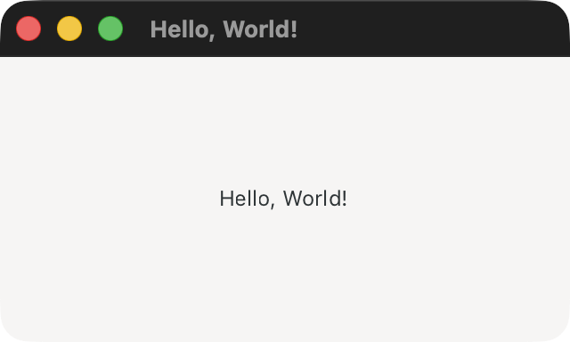

# C · desktop: Hello, World!

> Part of [Hello World in many languages](../../../README.md) ·
> Language overview: [C](../README.md)

## What this is
A desktop program that opens a small window titled "Hello, World!" with
the text **Hello, World!** in the middle. The window is drawn by **GTK 4**,
"a free and open-source cross-platform widget toolkit" maintained by
GNOME [1]. GTK "is written in C but has been designed to support a wide
range of languages" [1], so C is its native language: `hello.c` calls GTK's
own API, with no binding layer in between.

Compare [../cli](../cli/): `main` no longer prints and returns. It hands
control to GTK's event loop, which waits for window events until you close
the window.

The code is compiled as **C99** (`-std=c99 -pedantic`), not C89 like
[../cli](../cli/), because GTK's headers are not valid C89 (see
[Why C99 here](#why-c99-here)).

## Prerequisites
| Tool | Version used (macOS Intel) | Why it is needed |
|---|---|---|
| A C compiler (`cc`) | Apple clang 21.0.0 (Command Line Tools 26.6) | compiles `hello.c` |
| pkg-config | pkgconf 3.0.10 (Homebrew) | prints the flags for GTK and the libraries under it |
| GTK 4 | 4.24.1, built from GNOME's source release by `install.sh` (see below) | the GUI toolkit |
| GTK's dependencies | GLib 2.90, Pango 1.58, Cairo 1.18, HarfBuzz, Graphene, libepoxy, ... (Homebrew) | GTK is built on them; `pkg-config` adds them automatically |
| macOS Intel only: Meson, Ninja | Meson 1.12.1, Ninja 1.13.2 (Homebrew) | to build GTK from source |

**macOS Intel needs a source build of GTK.** Homebrew's `gtk4` formula has
ready-made packages (bottles) for Apple Silicon and Linux only, not for
Intel Macs [2]. Without a bottle, Homebrew builds from source, and its formula
lists `dart-sass` as a build dependency [3]. On the test machine (Command Line
Tools only, no Xcode app), that build failed with:
```text
dartaotruntime: A full installation of Xcode.app is required to compile
this software. Installing just the Command Line Tools is not sufficient.
```
GTK's release tarball does not need Sass: GTK's `meson.build` only
compiles its theme with Sass "For git checkouts, but not for tarballs",
because the tarball already contains the compiled CSS files [4]. Therefore, on
Intel Macs, `install.sh` offers to build GTK itself from the tarball, following
GTK's own instructions ("meson setup --prefix /opt/gtk builddir", then
compile and install) [5]:

1. `brew install` GTK's runtime dependencies (the list from Homebrew's
   formula [3]) and the build tools Meson and Ninja. Most of them have Intel
   bottles; a few may be compiled by Homebrew, which takes longer.
2. Download `gtk-4.24.1.tar.xz` from `download.gnome.org` and check its
   SHA-256 against the value GNOME publishes [6].
3. `meson setup` with only the library enabled (no demos, tests,
   documentation, introspection, GStreamer, or Vulkan), then `meson
   install` into `~/.local/gtk-4.24.1`. No `sudo`: everything goes into
   your home folder. Delete that folder to uninstall.

`gtk4-env.sh` holds the version, checksum, and folder, and adds the
folder's `lib/pkgconfig` to `PKG_CONFIG_PATH` so that `pkg-config` (and
`build.sh`) find this GTK. On the test machine, the GTK build took
about 3.5 minutes (2026-10-31, from `meson setup` to the end of
`meson install`), plus the time Homebrew needed for the dependencies.
With the full Xcode app, `brew install gtk4` is expected to work instead
(not tested).

## Quick start
```sh
./install.sh   # check cc, pkg-config and GTK 4 (asks before installing; may build GTK)
./build.sh     # compile hello.c as C99 and link GTK into bin/hello-desktop
./run.sh       # open the window; close it to end the program
```

## Scripts explained
| Script | What it does | Why it is needed |
|---|---|---|
| `gtk4-env.sh` | Sourced by the other three: sets `GTK4_VERSION`, `GTK4_SHA256`, `GTK4_PREFIX` (default `~/.local/gtk-4.24.1`) and prepends `$GTK4_PREFIX/lib/pkgconfig` to `PKG_CONFIG_PATH`. | One place for the GTK version and folder. |
| `install.sh` | 1. Checks `cc`. 2. Checks `pkg-config`. 3. Checks `pkg-config --exists gtk4`. If GTK is missing: `brew install gtk4` on Apple Silicon, the source build above on Intel, `sudo apt-get install -y libgtk-4-dev` on Debian/Ubuntu, and the MSYS2 command on Windows. Everything runs only if you answer `y`. | C has no package manager of its own; GTK comes from the operating system's package manager or from source. |
| `build.sh` | Runs `cc -std=c99 -pedantic -Wall -Wextra <GTK's -I flags as -isystem> -o bin/hello-desktop hello.c $(pkg-config --libs gtk4)` and prints the expanded command (see [Why C99 here](#why-c99-here) for `-isystem`). | GTK's own getting-started page builds its example the same way: "gcc $( pkg-config --cflags gtk4 ) -o example-0 example-0.c $( pkg-config --libs gtk4 )" [7]. The expanded command is long: GTK's headers include GLib's, Pango's, Cairo's, and more, and `pkg-config` lists all their folders. |
| `run.sh` | Runs `./bin/hello-desktop`. `--verify` sets `TF_VERIFY=1`: the app prints the label's text once the window is shown and quits after about 2 s. | GTK is linked dynamically: the system's loader finds the GTK libraries when the program starts. |

**Linked, not copied.** `otool -L bin/hello-desktop` lists
13 shared libraries: `libgtk-4`, Pango, HarfBuzz, gdk-pixbuf, Cairo,
Graphene, GIO, GObject, GLib, `libintl`, and `libSystem`. The executable
is 9,888 bytes; compare 34.2 MB for the [Go/Fyne version](../../go/README.md#comparing-the-categories),
which copies its toolkit into the executable.

## Folder structure
```text
desktop/
├── README.md        this file
├── gtk4-env.sh      GTK version, checksum and install folder (sourced by the scripts)
├── install.sh       checks cc, pkg-config and GTK 4 (may build GTK on Intel Macs)
├── build.sh         compiles and links with GTK
├── run.sh           opens the window
├── screenshot.png   the window, for "Expected output" below
├── hello.c          the program
└── bin/             created by build.sh; not committed
    └── hello-desktop
```
One `.c` file, as in [../cli](../cli/README.md#folder-structure). Larger
GTK applications usually build with Meson (GTK itself does) and keep
their user interface in `.ui` XML files; a single label does not need
either.

## Step-by-step walkthrough
Open [`hello.c`](hello.c) next to this list. The structure is GTK's own
first example from its getting-started page, with a label added [7].

1. **`#include <gtk/gtk.h>`** brings in all of GTK, and GLib under it.
   GTK's names start with `gtk_`/`Gtk`, GLib's with `g_`/`G`: C has no
   namespaces, so prefixes keep names apart.
2. **`main`** now takes `int argc, char **argv`: the number of
   command-line arguments and the arguments themselves, which are passed on
   to GTK.
3. **`gtk_application_new("com.example.HelloDesktop", G_APPLICATION_DEFAULT_FLAGS)`**
   creates the application. GNOME uses "'reverse DNS' style identifiers
   for applications" and recommends a name "based on the global public DNS
   system" [8]; `example.com` is reserved for examples [9], so this ID
   belongs to nobody.
4. **`g_signal_connect(app, "activate", G_CALLBACK(activate), NULL)`**
   connects a *signal* to a function. "The activate signal will be emitted
   when your application is launched with g_application_run()" [7].
   `activate` is passed by name: in C that is a pointer to the function.
   `G_CALLBACK` casts it to GLib's generic callback type.
5. **`g_application_run(...)`** "Runs the application"; it "is intended to
   be run from main() and its return value is intended to be returned by
   main()" [10]. It returns only when the window is closed: the same
   pattern as the `mainloop()` of Python's `tkinter` and Fyne's `ShowAndRun()`.
6. **`activate(...)`** builds the window:
   - `gtk_application_window_new(app)` creates a window that belongs to
     the app.
   - `GTK_WINDOW(window)` is a checked cast. Every widget is a
     `GtkWidget *`; GTK implements classes and inheritance in plain C, and
     these macros convert a pointer to the more specific type.
   - `gtk_window_set_title` and `gtk_window_set_default_size` set the
     title and a starting size (320 × 160).
   - `gtk_label_new("Hello, World!")` "Creates a new label with the given
     text inside it" [11]; `gtk_window_set_child` "Sets the child widget of
     the window" [11].
   - `gtk_window_present` shows the window [7].
7. **The self-check** (only with `TF_VERIFY=1`, used by `./run.sh
   --verify`): it prints the label's text with `gtk_label_get_text`, and
   `g_timeout_add_seconds(2, quit_app, app)` calls `quit_app` after
   2 s. A GLib timeout "is called repeatedly until it returns
   G_SOURCE_REMOVE" [12]; `quit_app` returns exactly that after calling
   `g_application_quit`. Note the third argument, `app`: C has no closures,
   so the data a callback needs travels with it as a `void *` (GLib calls
   it `gpointer`).
8. **`g_object_unref(app)`** drops the reference to the application.
   GTK objects are reference-counted; C has no garbage collector.

### Why C99 here
Compile `hello.c` as C89 and the errors come from GLib's headers, not from
`hello.c`:
```text
$ cc -std=c89 -pedantic-errors $(pkg-config --cflags gtk4) -fsyntax-only hello.c
.../include/glib-2.0/glib/gunicode.h:308:71: error: commas at the end of enumerator lists are a C99-specific feature [-Werror,-Wc99-extensions]
.../include/glib-2.0/glib/gunicode.h:806:64: error: commas at the end of enumerator lists are a C99-specific feature [-Werror,-Wc99-extensions]
.../include/glib-2.0/glib/gstrfuncs.h:413:40: error: commas at the end of enumerator lists are a C99-specific feature [-Werror,-Wc99-extensions]
...
fatal error: too many errors emitted, stopping now [-ferror-limit=]
20 errors generated.
```
(Apple clang 21 on 2026-10-31; folders shortened to `...`. The other
errors are variadic macros, also "a C99 feature", in `gmessages.h` and
`genums.h`.)
GTK and GLib are written for C99 or newer (GTK itself builds with
`c_std=gnu11` [4]), so `build.sh` uses `-std=c99 -pedantic`. Even C99 is
not quite enough for GTK 4.24's headers: with plain `-I` flags, Apple
clang 21 prints 37 `-pedantic` warnings, all from GTK's headers and none
from `hello.c` (they use two C11 features: repeated `typedef`s and
`_Static_assert`). So `build.sh` passes GTK's folders with `-isystem`
instead of `-I`. The compiler treats those as system headers and does not
report warnings from them [18], while `hello.c` itself is still checked:
add a `_Static_assert` to it and `-std=c99 -pedantic` warns that it "is a
C11 extension".
`hello.c` itself keeps to C89 habits: `/* */` comments and declarations
at the top of each block.

## Why this toolchain
- **GTK 4** for the desktop version. GTK is written in C, it is
  maintained by GNOME, and applications such as GIMP and Inkscape are built
  with it [1].
- **Current and maintained.** GTK 4.0 was released on 2020-12-16 [13];
  on 2026-10-31, 4.24.1 is the newest release on `download.gnome.org` [6] and the version in
  Homebrew [2]. GTK is "released under the terms of the GNU Lesser General
  Public License" [1].
- **Cross-platform.** GTK documents installation on Linux, Windows (via
  MSYS2), and macOS [14][16][17]. Its build has a back end per windowing
  system; this macOS build uses `-Dmacos-backend=true -Dx11-backend=false`
  (options from GTK's `meson.options` [4]), so the window is a native macOS
  window and no X server is involved.

## Platform notes
| Platform | Status | Notes |
|---|---|---|
| macOS Intel | ✅ verified (2026-10-31) | GTK 4.24.1 built from source by `install.sh` (no Intel bottle; see Prerequisites), Homebrew dependencies, Apple clang 21.0.0. |
| macOS Apple Silicon | ⚠️ not verified | `brew install gtk4` installs a bottle [2]; `install.sh` does that. |
| Linux (Debian/Ubuntu) | ⚠️ not verified | GTK's Linux page lists `libgtk-4-dev` as the development package for Debian/Ubuntu [14]: `sudo apt-get install -y build-essential pkg-config libgtk-4-dev`. Debian stable has GTK 4.18 [15]; the functions used here all exist there. |
| Windows (Git Bash / WSL) | ⚠️ not verified | GTK's Windows page: install MSYS2, then `pacman -S mingw-w64-ucrt-x86_64-gtk4` (and `mingw-w64-ucrt-x86_64-toolchain base-devel` for the compiler) [16]. Name the output `bin/hello-desktop.exe`. Under WSL, a window needs WSLg or an X server. |

## Expected output
`./run.sh` opens this window:



(Taken on 2026-10-31 on macOS Intel with `screencapture -x -o -l <window-id> screenshot.png`,
which captures only that window.)

`./run.sh --verify` prints:
```text
==> Open the Hello World window
    WHY: GTK, loaded by bin/hello-desktop, opens the window and draws the label.
    Self-check: the app prints the label text and closes after ~2 seconds.
Hello, World!
```
On the test machine, GTK's macOS back end may also print a line such as
`Gdk-WARNING **: gdk_frame_timings_presented() called on skipped frame.`
to stderr. It comes from GTK, not from `hello.c`; the window is drawn and
the program exits with status 0.

## Sources
1. The GTK Project (home page: description, license, written in C, GNOME, apps). <https://www.gtk.org/> (accessed 2026-10-31)
2. gtk4 (formula: versions and bottles). Homebrew Formulae. <https://formulae.brew.sh/formula/gtk4> (accessed 2026-10-31)
3. gtk4.rb (formula source: dependencies, build options). Homebrew/homebrew-core (GitHub). <https://github.com/Homebrew/homebrew-core/blob/HEAD/Formula/g/gtk4.rb> (accessed 2026-10-31)
4. GTK 4.24.1 source release: `meson.build` (`c_std=gnu11`), `meson.options` and `gtk/meson.build` (theme compiled only for git checkouts). GNOME. <https://download.gnome.org/sources/gtk/4.24/gtk-4.24.1.tar.xz> (accessed 2026-10-31)
5. Compiling the GTK Libraries. GTK 4 documentation. <https://docs.gtk.org/gtk4/building.html> (accessed 2026-10-31)
6. GTK 4.24 source releases and checksum file. GNOME. <https://download.gnome.org/sources/gtk/4.24/> and <https://download.gnome.org/sources/gtk/4.24/gtk-4.24.1.sha256sum> (accessed 2026-10-31)
7. Getting Started with GTK (Basics example, compile command). GTK 4 documentation. <https://docs.gtk.org/gtk4/getting_started.html> (accessed 2026-10-31)
8. Application ID. GNOME Developer Documentation. <https://developer.gnome.org/documentation/tutorials/application-id.html> (accessed 2026-10-31)
9. RFC 2606: Reserved Top Level DNS Names. IETF. <https://www.rfc-editor.org/rfc/rfc2606> (accessed 2026-10-31)
10. `g_application_run`. GIO documentation. <https://docs.gtk.org/gio/method.Application.run.html> (accessed 2026-10-31)
11. GtkLabel (`gtk_label_new`) and `gtk_window_set_child`. GTK 4 documentation. <https://docs.gtk.org/gtk4/class.Label.html>, <https://docs.gtk.org/gtk4/method.Window.set_child.html> (accessed 2026-10-31)
12. `g_timeout_add_seconds`. GLib documentation. <https://docs.gtk.org/glib/func.timeout_add_seconds.html> (accessed 2026-10-31)
13. GTK 4.0. GTK Development Blog, 2020-12-16. <https://blog.gtk.org/2020/12/16/gtk-4-0/> (accessed 2026-10-31)
14. Installing GTK on Linux. The GTK Project. <https://www.gtk.org/docs/installations/linux> (accessed 2026-10-31)
15. Package libgtk-4-dev (stable). Debian. <https://packages.debian.org/stable/libgtk-4-dev> (accessed 2026-10-31)
16. Installing GTK on Windows. The GTK Project. <https://www.gtk.org/docs/installations/windows> (accessed 2026-10-31)
17. Installing GTK on macOS. The GTK Project. <https://www.gtk.org/docs/installations/macos> (accessed 2026-10-31)
18. System Headers. The C Preprocessor, GCC. <https://gcc.gnu.org/onlinedocs/cpp/System-Headers.html> (accessed 2026-10-31)
