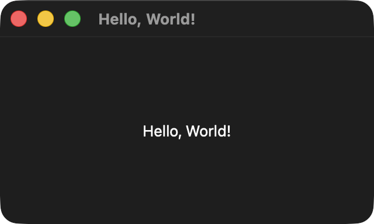

# C++ · desktop: Hello, World!

> Part of [Hello World in many languages](../../../README.md) ·
> Language overview: [C++](../README.md)

## What this is
A desktop program that opens a native window titled "Hello, World!" that
shows the text `Hello, World!` in its center. The window is drawn by
**Qt 6 Widgets**. Qt is a GUI toolkit written in C++, and the code is
compiled as ISO C++20 with CMake.

It is the C++ twin of the [C desktop](../../c/desktop/), which uses GTK 4.
Both programs do the same thing: create an application object, create a
label, show it, run the event loop. The difference is the language. GTK
emulates classes in C with structs, cast macros, and `void *` callbacks.
Qt has real classes, objects on the stack, and lambdas.

## Prerequisites
| Tool | Version used (macOS Intel) | Why it is needed |
|---|---|---|
| A C++ compiler (`c++`) | Apple clang 21.0.0 (Command Line Tools) | compiles `hello.cpp` |
| CMake | 4.4.5 (Homebrew) | finds Qt and generates the build files |
| Qt 6 base (`qtbase`) | 6.12.0 (Homebrew) | the Qt Widgets, Qt GUI, and Qt Core modules |

"Qt 6 requires a compiler supporting C++ version 17 or newer" [1]; this
folder uses C++20.

## Quick start
```sh
./install.sh   # check for c++, CMake and Qt 6 (asks before installing)
./build.sh     # configure and build into build/hello-desktop
./run.sh       # open the window (close it to quit)
```

## Scripts explained
| Script | What it does | Why it is needed |
|---|---|---|
| `install.sh` | Checks `c++`, `cmake`, and Qt 6. For Qt, it looks for `Qt6Config.cmake`, the file `find_package(Qt6)` loads. If something is missing, it offers `brew install qtbase` (macOS) or `sudo apt-get install -y qt6-base-dev` (Debian/Ubuntu), or prints the MSYS2 commands (Windows), and runs them only if you answer `y`. | Standard C++ has no windows, so the GUI comes from a library. C++ has no package manager of its own. |
| `build.sh` | Runs `cmake -S . -B build -DCMAKE_BUILD_TYPE=Release`, then `cmake --build build`. | Configure finds Qt; build compiles and links. |
| `run.sh` | Runs `./build/hello-desktop`. `--verify` sets `TF_VERIFY=1`: the app prints the label text and quits after 2 s. | A desktop app normally waits for the user; the self-check lets `scripts/verify-all.sh` run it unattended. |

**Only `qtbase`.** Qt is split into modules. Homebrew's `qtbase` formula
contains Qt Core, Qt GUI, and Qt Widgets, which is all this program uses.
On Intel Macs, Homebrew has no ready-made (bottled) `qtbase`: its macOS
bottles are for Apple Silicon only [2]. Therefore, on the test machine,
`brew install qtbase` compiled Qt from source, which takes much longer than downloading a
bottle. On Apple Silicon and on Linux, the package is downloaded ready-made.

**What `CMakeLists.txt` does.** It follows the pattern of Qt's "Getting
started with CMake" guide [1]:
```cmake
find_package(Qt6 REQUIRED COMPONENTS Widgets)   # find Qt through Qt6Config.cmake
qt_standard_project_setup()                     # Qt's default project settings
qt_add_executable(hello-desktop hello.cpp)      # Qt's wrapper of add_executable
target_link_libraries(hello-desktop PRIVATE Qt6::Widgets)
```
`find_package` does the job that `pkg-config --cflags --libs gtk4` does in
the [C desktop](../../c/desktop/README.md): it tells the compiler where
the headers and libraries are. `Qt6::Widgets` also brings in Qt GUI and Qt Core.
The build log shows `Automatic MOC and UIC`: `qt_standard_project_setup`
turns on Qt's code generators (`moc`, for classes with signals and slots).
This program defines no such class, so they have nothing to do.

## Folder structure
```text
desktop/
├── README.md        this file
├── install.sh       checks / installs c++, CMake and Qt 6
├── build.sh         configures and builds with CMake
├── run.sh           opens the window (--verify: self-check)
├── CMakeLists.txt   the CMake project: C++20, links Qt6::Widgets
├── hello.cpp        the program
├── screenshot.png   the window, for "Expected output" below
└── build/           created by build.sh; not committed
    └── hello-desktop
```
Qt's guide puts `CMakeLists.txt` next to the sources, as here [1]. A
larger Qt application adds `.ui` files (forms made in Qt Designer) and one `.cpp`
/ `.h` pair per window class.

## Step-by-step walkthrough
Open [`hello.cpp`](hello.cpp) next to
[`../../c/desktop/hello.c`](../../c/desktop/hello.c).

1. **Headers.** One header per class: `<QApplication>`, `<QLabel>`,
   `<QTimer>`. C's `<cstdlib>` and `<cstring>` are the C headers
   `stdlib.h` and `string.h` with their names in namespace `std` [3].
   GTK brings in everything with one `<gtk/gtk.h>`.
2. **`QApplication app(argc, argv);`** "The QApplication class manages the
   GUI application's control flow and main settings" [4]. `app` is an
   object declared like an `int`, on the stack. When `main` returns, C++
   calls its *destructor* automatically and Qt cleans up. This is RAII
   ("resource acquisition is initialization"). The C version must call
   `g_object_unref(app)` itself.
3. **`QLabel label("Hello, World!");`** "The QLabel widget provides a
   text or image display" [5]. A widget created without a parent becomes a
   window of its own, so no separate window object is needed. GTK needs
   `gtk_application_window_new` plus `gtk_window_set_child`.
4. **Member functions.** `label.setWindowTitle(...)`,
   `label.setAlignment(Qt::AlignCenter)`, `label.resize(320, 160)`,
   `label.show()`. The object comes before the dot. In GTK's C API, the
   object is the first argument and must be cast with a macro first:
   `gtk_window_set_title(GTK_WINDOW(window), ...)`. In C++, the compiler
   knows that a `QLabel` is a `QWidget` (inheritance), so no cast is needed.
5. **Self-check (`TF_VERIFY=1`).** The program prints `label.text()` and
   calls `QTimer::singleShot(2000, [&app] { app.quit(); });`. The function
   `singleShot` "calls functor after interval" [6]. The functor here is a
   **lambda**: an unnamed function written in place, which captures `app`
   by reference (`[&app]`). The C version needs a separate named function,
   `quit_app`, and passes the app to it as a `gpointer` (a `void *`).
6. **`return app.exec();`** "Enters the main event loop and waits until
   exit() is called" [4]. The event loop "receives events from the window
   system and dispatches these to the application widgets" [4]. This is
   GTK's `g_application_run`.
7. **Signals and slots.** Qt connects objects with *signals and slots*:
   "In Qt, we have an alternative to the callback technique: We use
   signals and slots" [7]. Qt says this is "type safe: The signature of a
   signal must match the signature of the receiving slot" [7]. A GTK signal
   handler gets its data through `gpointer`, which the compiler cannot
   check. This Hello World program needs no signal; `singleShot` is the only
   callback.
8. **Size and libraries.** `build/hello-desktop` is 32,840 bytes on the test
   machine (macOS Intel); `otool -L` lists the QtWidgets, QtGui and QtCore frameworks from
   Homebrew, Apple system frameworks (AppKit, Metal, ...), `libc++`, and
   `libSystem`. Like the C version, the program is small because the
   toolkit is linked dynamically.

## Why this toolchain
- **Qt 6 Widgets.** Qt is written
  in C++, so its API is the toolkit's own API, not a binding. Widgets is
  Qt's classic module of desktop controls (labels, buttons, windows); it
  is part of `qtbase`, so nothing beyond the base module is needed.
- **License.** "Qt licensed under the GNU Lesser General Public License
  (LGPL) version 3 is appropriate for the development of Qt applications
  provided you can comply with the terms and conditions of the GNU LGPL
  version 3 (or GNU GPL version 3)" [8].
- **CMake.** Qt 6 documents CMake for building Qt projects and provides its
  own CMake commands (`qt_add_executable`, `qt_standard_project_setup`)
  [1]. Qt also requires a recent CMake: projects "are required to set
  version 3.16 or newer in the cmake_minimum_required command" [9]; this one
  sets 3.20, like the other C++ folders.
- **Homebrew `qtbase` instead of Qt's online installer.** On macOS, this
  repository installs toolchains with Homebrew. The `qtbase` formula
  contains only the base modules, while the full `qt` formula depends on
  every other Qt module formula as well [2][12].

## Platform notes
| Platform | Status | Notes |
|---|---|---|
| macOS Intel | ✅ verified (2026-11-01) | Apple clang 21.0.0, CMake 4.4.5, Qt 6.12.0 (`qtbase`, built from source by Homebrew: no Intel bottle [2]). `./run.sh --verify` printed `Hello, World!`; the program is a plain executable, not a `.app` bundle. |
| macOS Apple Silicon | ⚠️ not verified | `brew install qtbase` downloads a bottle [2]; same commands. |
| Linux (Debian/Ubuntu) | ⚠️ not verified | `sudo apt-get install -y build-essential cmake qt6-base-dev` [10]. Needs a graphical session (X11 or Wayland). |
| Windows (Git Bash / WSL) | ⚠️ not verified | Install MSYS2; in the "MSYS2 UCRT64" shell run `pacman -S mingw-w64-ucrt-x86_64-gcc mingw-w64-ucrt-x86_64-cmake mingw-w64-ucrt-x86_64-qt6-base` [11] and add `C:\msys64\ucrt64\bin` to `PATH`. Then `cmake -S . -B build -G "MinGW Makefiles"`, `cmake --build build`, `build\hello-desktop.exe`. With Qt's own installer instead, pass its folder with `CMAKE_PREFIX_PATH`. WSL needs WSLg to show windows. |

## Expected output
`./run.sh` opens a window titled "Hello, World!" with the text
`Hello, World!` in the middle. Close it to end the program.



(Taken on 2026-11-01 on macOS Intel with `screencapture -x -o -l <window-id> screenshot.png`,
which captures only that window.)

`./run.sh --verify` (used by `scripts/verify-all.sh`):
```text
==> Open the Hello World window
    WHY: Qt, loaded by build/hello-desktop, opens the window and draws the label.
    Self-check: the app prints the label text and closes after ~2 seconds.
Hello, World!
```

## Sources
1. Getting started with CMake (Qt 6; C++17 requirement, example CMakeLists.txt). The Qt Company. <https://doc.qt.io/qt-6/cmake-get-started.html> (accessed 2026-11-01)
2. `qtbase` (Homebrew formula: version and bottles). Homebrew. <https://formulae.brew.sh/formula/qtbase> (accessed 2026-11-01)
3. C++ working draft, [headers] (C++ headers for C library facilities). ISO/IEC JTC1/SC22/WG21 draft, HTML edition. <https://eel.is/c++draft/headers> (accessed 2026-11-01)
4. QApplication Class (Qt 6). The Qt Company. <https://doc.qt.io/qt-6/qapplication.html> (accessed 2026-11-01)
5. QLabel Class (Qt 6). The Qt Company. <https://doc.qt.io/qt-6/qlabel.html> (accessed 2026-11-01)
6. QTimer Class (Qt 6; `singleShot`). The Qt Company. <https://doc.qt.io/qt-6/qtimer.html> (accessed 2026-11-01)
7. Signals & Slots (Qt 6). The Qt Company. <https://doc.qt.io/qt-6/signalsandslots.html> (accessed 2026-11-01)
8. Qt Licensing (Qt 6). The Qt Company. <https://doc.qt.io/qt-6/licensing.html> (accessed 2026-11-01)
9. Supported CMake Versions (Qt 6). The Qt Company. <https://doc.qt.io/qt-6/cmake-supported-cmake-versions.html> (accessed 2026-11-01)
10. Package qt6-base-dev (stable). Debian. <https://packages.debian.org/stable/qt6-base-dev> (accessed 2026-11-01)
11. mingw-w64-qt6-base (MSYS2 package). MSYS2 project. <https://packages.msys2.org/base/mingw-w64-qt6-base> (accessed 2026-11-01)
12. `qt` (Homebrew formula: dependencies). Homebrew. <https://formulae.brew.sh/formula/qt> (accessed 2026-11-03)
