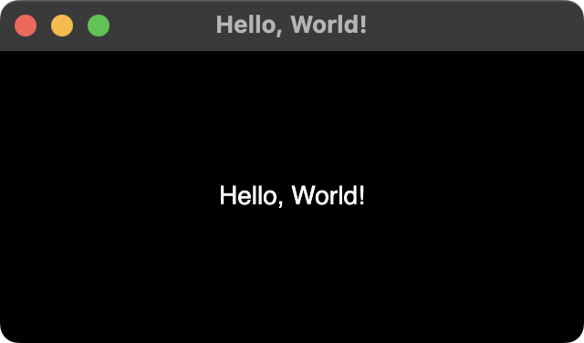

# C# · desktop: Hello, World!

> Part of [Hello World in many languages](../../../README.md) ·
> Language overview: [C#](../README.md)

## What this is
A desktop program that opens a window titled **Hello, World!** that shows
the text **Hello, World!** in the middle. The window is drawn by
**Avalonia**, an open-source, cross-platform user interface (UI) toolkit for .NET [1],
downloaded from NuGet, the .NET package registry.

Microsoft's own desktop toolkits do not cover all three desktop platforms. "WPF only runs on
Windows" [2]. Windows Forms "is a UI framework for building Windows
desktop apps" [3]. .NET MAUI runs "on Android, iOS, macOS, and Windows" [4], and Linux is not in that list. Avalonia runs on Windows, macOS, and Linux [1], so the same
code builds on all three.

## Prerequisites
| Tool | Version used (macOS Intel) | Why it is needed |
|---|---|---|
| .NET SDK 10 | 10.0.403 (runtime 10.0.14), in `~/.dotnet` | the C# compiler, MSBuild, the .NET runtime, and `dotnet restore` for the packages |
| Avalonia | 12.1.4 (`Avalonia`, `Avalonia.Desktop`, `Avalonia.Themes.Fluent`) | the UI toolkit; downloaded by `install.sh` from nuget.org |
| Internet access | the first time only | `dotnet restore` downloads 25 packages (about 295 MB of `.nupkg` files on the development machine) into `~/.nuget/packages` |

## Quick start
```sh
./install.sh   # check for the .NET 10 SDK; download Avalonia (asks before installing the SDK)
./build.sh     # compile into bin/Release/net10.0/hello-desktop.dll
./run.sh       # open the window; close it to end the program
```

## Scripts explained
| Script | What it does | Why it is needed |
|---|---|---|
| `install.sh` | 1. Checks for a .NET SDK 10 or newer, as in [../cli](../cli/README.md#scripts-explained). 2. Runs `dotnet restore`. | Avalonia is not part of .NET: "the .NET CLI uses NuGet to look for these dependencies and download them if necessary" [5]. They go into "the `.nuget/packages` directory in the user's home directory" [5], shared by all projects. |
| `build.sh` | Runs `dotnet build -c Release --disable-build-servers`. | Compiles `Program.cs` to IL and copies Avalonia's `.dll` files and native libraries into `bin/Release/net10.0/`. |
| `run.sh` | Runs `dotnet bin/Release/net10.0/hello-desktop.dll`. `--verify` sets `TF_VERIFY=1`: the app prints the text once the window is open and closes after about 2 seconds. | The .NET runtime runs the IL; Avalonia opens a native window. |

**Telemetry.** Besides `DOTNET_CLI_TELEMETRY_OPTOUT` (see
[../cli](../cli/README.md#scripts-explained)), `install.sh` and `build.sh`
set `AVALONIA_TELEMETRY_OPTOUT=1`. Avalonia's packages bring in a package
called `Avalonia.BuildServices` (version 11.3.2 here). Its README, in
`~/.nuget/packages/avalonia.buildservices/11.3.2/README.md`, says that
"Avalonia collects anonymous build-time usage data" and lists, for
example, a hashed project name and an "Anonymous machine identifier
(GUID), and machine name (hashed)". It names that variable as the way to
opt out [6]. The data is collected at build time only, not when the app
runs [6].

## Folder structure
```text
desktop/
├── README.md              this file
├── install.sh             checks the .NET SDK; runs dotnet restore
├── build.sh               compiles with dotnet build
├── run.sh                 opens the window
├── screenshot.png         the window, for "Expected output" below
├── hello-desktop.csproj   the project file, with the Avalonia PackageReferences
├── Program.cs             the program: Main, the App class and the window
├── obj/                   created by restore/build; not committed
└── bin/Release/net10.0/   created by build.sh; not committed
    ├── hello-desktop.dll  the program, as IL
    ├── Avalonia*.dll, SkiaSharp.dll, HarfBuzzSharp.dll, ...   the toolkit
    └── runtimes/<platform>/native/   native libraries for each platform
```
- Avalonia's app template splits an app into `Program.cs`, `App.axaml`,
  `App.axaml.cs`, `MainWindow.axaml` and `MainWindow.axaml.cs` [7].
  "The `.axaml` extension is short for Avalonia XAML" [12], an XML
  language for describing the UI. Avalonia also documents
  apps with no XAML at all: "Avalonia does not require XAML. You can build
  entire applications using only C#" [8]. This program does that, so it
  is one file, like [../../java/desktop](../../java/desktop/) and
  [../../cpp/desktop](../../cpp/desktop/).
- `bin/Release/net10.0/` is about 560 MB on the development machine. The build
  copies the native libraries for every platform Avalonia supports
  (`runtimes/win-x64`, `linux-x64`, `osx`, ...), and the three Windows
  folders alone are about 118 MB each. Only `runtimes/osx/native` is used
  on a Mac.
- `bin/` and `obj/` are ignored by the root `.gitignore`.

## Step-by-step walkthrough
Open [`Program.cs`](Program.cs) and [`hello-desktop.csproj`](hello-desktop.csproj).

1. **`<PackageReference Include="Avalonia" Version="12.1.4" />`** in the
   project file lists a NuGet package with an exact version, the way a
   `<dependency>` does in Maven's `pom.xml`. `Avalonia.Desktop` adds the desktop back ends, and `Avalonia.Themes.Fluent` adds the look of the controls.
   `<OutputType>WinExe</OutputType>` marks a GUI program. On Windows it
   starts without a console window.
2. **`class Program { [STAThread] static void Main(string[] args) ... }`**:
   unlike [../cli](../cli/), this file declares classes, so the entry
   point is written out: a `static` method called `Main`, as in Java.
   `[STAThread]` is an *attribute*, extra information attached to the
   method. It is for Windows UI code, and Avalonia's app template puts
   it on `Main` too [13].
3. **`AppBuilder.Configure<App>().UsePlatformDetect().StartWithClassicDesktopLifetime(args);`**
   is the startup pattern from Avalonia's docs [9]. `Configure<App>()`
   names the application class (`<App>` is a generic type argument).
   `UsePlatformDetect()` picks the back end for the current OS, and
   `StartWithClassicDesktopLifetime` runs the event loop until the main
   window closes [9]. Each call returns the builder, so the calls are
   chained.
4. **`class App : Application`** inherits from Avalonia's `Application`,
   like `extends` in Java. **`public override void Initialize()`** adds
   the Fluent theme. C# requires the word `override`. In Java,
   `@Override` is optional.
5. **`if (ApplicationLifetime is IClassicDesktopStyleApplicationLifetime desktop)`**
   is *pattern matching*: it tests the type and, if it matches, declares
   `desktop` with that type in one step.
6. **`new Window { Title = ..., Content = new TextBlock { ... } }`** is an
   *object initializer*: it creates the object and sets its properties in
   one expression. `Content` is what the window shows, here a `TextBlock`,
   a control that displays text, centered.
7. **The self-check.** With `TF_VERIFY=1`, `window.Opened += (s, e) => { ... };`
   subscribes a lambda to the window's `Opened` event (`+=` adds an event
   handler; events are part of the C# language). The
   lambda prints the TextBlock's text and calls `DispatcherTimer.RunOnce`
   to close the window 2 seconds later on the UI thread. A student running
   `./run.sh` never sees this.

## Why this toolchain
- **Avalonia** describes itself as a way to "Build cross-platform desktop,
  mobile, and web apps with shared XAML and C#", and it is "MIT licensed"
  [1]. The latest stable version on NuGet on 2026-11-01 was 12.1.4 [10]. This repository uses Avalonia because Microsoft's own toolkits do not cover all
  three desktop platforms: WPF and Windows Forms are Windows-only [2][3],
  and MAUI has no Linux target [4].
- **Code only, no XAML.** XAML is the usual way to write Avalonia UIs
  [7][12], but one C# file keeps Hello World comparable with the other
  desktop folders. Avalonia documents this style itself [8].

## Platform notes
| Platform | Status | Notes |
|---|---|---|
| macOS Intel | ✅ verified (2026-11-01) | .NET SDK 10.0.403, Avalonia 12.1.4. The window follows the system appearance: "By default, Avalonia inherits the theme variant set by the system-wide user preference" [11], so it is dark on the development machine. |
| macOS Apple Silicon | ⚠️ not verified | Same commands. The native libraries in `runtimes/osx/native` are universal binaries (`file` reports `x86_64` and `arm64`). |
| Linux (Debian/Ubuntu) | ⚠️ not verified | Install the SDK as in [../cli](../cli/README.md#platform-notes).  |
| Windows (Git Bash / WSL) | ⚠️ not verified | `winget install --id Microsoft.DotNet.SDK.10 -e`. Native PowerShell: `dotnet build -c Release`, then `bin\Release\net10.0\hello-desktop.exe`. |

## Expected output
`./run.sh --verify`:
```text
==> Open the Hello World window
    WHY: the .NET runtime runs the program; Avalonia opens the window and draws the text.
    Self-check: the app prints the text and closes after ~2 seconds.
Hello, World!
```
`./run.sh` opens this window:



(Taken on 2026-11-01 on macOS Intel with `screencapture -x -o -l <window id>`,
which captures only this window.)

## Sources
1. Avalonia UI (home page: platforms, MIT license). AvaloniaUI OÜ. <https://avaloniaui.net/> (accessed 2026-11-01)
2. What is Windows Presentation Foundation (WPF). Microsoft Learn. <https://learn.microsoft.com/dotnet/desktop/wpf/overview> (accessed 2026-11-01)
3. What is Windows Forms. Microsoft Learn. <https://learn.microsoft.com/dotnet/desktop/winforms/overview> (accessed 2026-11-01)
4. What is .NET MAUI? Microsoft Learn. <https://learn.microsoft.com/dotnet/maui/what-is-maui> (accessed 2026-11-01)
5. `dotnet restore` command. Microsoft Learn. <https://learn.microsoft.com/dotnet/core/tools/dotnet-restore> (accessed 2026-11-01)
6. Avalonia.BuildServices 11.3.2 package README ("Avalonia Telemetry"), installed in `~/.nuget/packages/avalonia.buildservices/11.3.2/README.md`; package page: NuGet Gallery. <https://www.nuget.org/packages/Avalonia.BuildServices> (accessed 2026-11-01)
7. Avalonia.Templates: templates/csharp/app (the `avalonia.app` template files). AvaloniaUI, GitHub. <https://github.com/AvaloniaUI/Avalonia.Templates/tree/main/templates/csharp/app> (accessed 2026-11-01)
8. Code-only UI. Avalonia Docs. <https://docs.avaloniaui.net/docs/fundamentals/coded-ui> (accessed 2026-11-01)
9. Application lifetimes. Avalonia Docs. <https://docs.avaloniaui.net/docs/concepts/application-lifetimes> (accessed 2026-11-01)
10. Avalonia 12.1.4. NuGet Gallery. <https://www.nuget.org/packages/Avalonia> (accessed 2026-11-01)
11. Theme variants. Avalonia Docs. <https://docs.avaloniaui.net/docs/styling/theme-variants> (accessed 2026-11-01)
12. Create your first project. Avalonia Docs. <https://docs.avaloniaui.net/docs/get-started/create-your-first-project> (accessed 2026-11-01)
13. Avalonia.Templates: templates/csharp/app/Program.cs. AvaloniaUI, GitHub. <https://github.com/AvaloniaUI/Avalonia.Templates/blob/main/templates/csharp/app/Program.cs> (accessed 2026-11-01)
