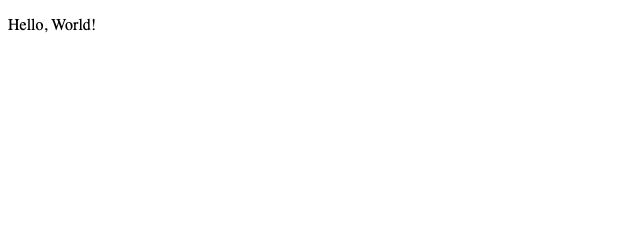

# C# · web-angular: Hello, World!

> Part of [Hello World in many languages](../../../README.md) ·
> Language overview: [C#](../README.md)

## What this is
A web application split into **two separate programs**, the same pattern as
[../../java/web-react](../../java/web-react/) and
[../../go/web-vue](../../go/web-vue/):

- **`backend/`**: an ASP.NET Core API in C#. It sends no HTML. It answers
  `GET /api/hello` with the JSON `{"message":"Hello, World!"}`.
- **`frontend/`**: an Angular app in TypeScript, built and served by the
  Angular CLI. The browser loads it, Angular calls `/api/hello` and shows
  the message as **Hello, World!**

Compare [../web](../web/), where the C# server sends the finished HTML
itself. Here the page is built **in the browser**, and C# only provides the
data. The two parts talk over HTTP.

```text
 browser ──GET /──────────► ng serve (frontend, :4200) ── sends index.html + Angular code
 browser ──GET /api/hello─► ng serve (frontend, :4200) ──proxy──► ASP.NET Core API (backend, :8080)
                                                       ◄── {"message":"Hello, World!"}
 Angular draws <p>Hello, World!</p>
```

## Prerequisites
| Tool | Version used (macOS Intel) | Why it is needed |
|---|---|---|
| .NET SDK 10 | 10.0.403 (ASP.NET Core 10.0.14), in `~/.dotnet` | compiles and runs the back end; ASP.NET Core comes with it |
| Node.js (^22.22.3, ^24.15.0, or ^26.0.0) with npm | Node.js 26.8.2, npm 12.2.1 | runs the Angular CLI; npm installs the front end's packages |
| Angular | `@angular/core` 22.2.4, `@angular/cli` and `@angular/build` 22.2.5, TypeScript 6.0.3 (`frontend/package-lock.json`) | the UI framework, its build tool and the TypeScript compiler; installed by `install.sh` with `npm ci` |
| `curl` | system `curl` | only for `./run.sh --verify` and for testing by hand |
| Google Chrome or Chromium | optional | `./run.sh --verify` uses it, if present, to check the page Angular draws |

The Node.js versions are the ones Angular 22.x supports: "^22.22.3 ||
^24.15.0 || ^26.0.0" [1].

## Quick start
```sh
./install.sh   # check .NET and Node.js; install the front end's packages (asks first)
./build.sh     # build backend/bin/Release/net10.0/hello-api.dll and frontend/dist/
./run.sh       # start both: API on :8080, front end on http://localhost:4200
```
Open <http://localhost:4200/> in a browser. Ctrl+C stops both servers.
Other ports: `PORT=9000 FE_PORT=5000 ./run.sh` (`PORT` is the API,
`FE_PORT` the front end, as in [../../go/web-vue](../../go/web-vue/)).

## Scripts explained
| Script | What it does | Why it is needed |
|---|---|---|
| `install.sh` | 1. Checks for a .NET SDK 10 or newer and offers `dotnet-install.sh` / `winget`, as in [../cli](../cli/README.md#scripts-explained). 2. Checks for a Node.js version Angular 22 supports, and npm. 3. Runs `npm ci` in `frontend/` if `node_modules` is missing. Anything missing is offered with its install command and runs only if you answer `y`. | Each part has its own toolchain. `npm ci` installs exactly the versions in `package-lock.json` [2]. |
| `build.sh` | 1. `dotnet build -c Release` in `backend/` → `backend/bin/Release/net10.0/hello-api.dll`. 2. `ng build` in `frontend/` → `frontend/dist/frontend/browser/`. | C# compiles to intermediate language (IL), as in [../cli](../cli/README.md#scripts-explained). Browsers do not run TypeScript or Angular templates, so the Angular CLI compiles and bundles them into plain JavaScript. |
| `run.sh` | Starts the API from `backend/`, waits until `/api/hello` answers, then starts `ng serve` in `frontend/`. `--verify`: calls `/api/hello` **through the front end's port** with `curl`, loads the page in headless Chrome if installed and prints what Angular drew, then stops both. | The two parts are separate programs, so both must run. A `trap` stops both servers when the script ends or you press Ctrl+C. |

**Why `run.sh` uses `ng serve` and not the `dist/` folder.** The Vite
front ends in this repository serve their build with `vite preview`.
This folder uses the Angular CLI's own server, `ng serve`, and the Angular docs describe proxying to a back end with it: "Use proxying
support to divert certain URLs to a backend server, by passing a file to
the `--proxy-config` build option" [3]. `ng serve` compiles the app again,
in memory, every time it starts. `frontend/dist/frontend/browser/` is what
you would copy to a real web server [4]. `build.sh` still runs `ng build`
so you can see that the production build compiles.

**Why `PORT` is removed for `ng serve`.** The Angular docs for `--port`
say: "The `PORT` environment variable, when set, takes precedence over
this option" [5]. Every web folder in this repository uses `PORT` for the
server's port, here the API's. If `ng serve` saw it, it would try to use
the API's port too and fail ("Port 8080 is already in use", seen on the
development machine). So `run.sh` starts `ng serve` without `PORT` and passes
the API's port as `API_PORT`, which `proxy.conf.js` reads.

**Analytics and telemetry.** The scripts set `DOTNET_CLI_TELEMETRY_OPTOUT=1`
(see [../cli](../cli/README.md#scripts-explained)). For Angular, "The
Angular Team does not collect usage statistics unless you explicitly opt
in" [6]. `angular.json` sets `"analytics": false` and the scripts set
`NG_CLI_ANALYTICS=false`, so the CLI never asks. Both are read by the
Angular CLI 22: the first is in its workspace schema
(`node_modules/@angular/cli/lib/config/schema.json`), the second in
`node_modules/@angular/cli/src/utilities/environment-options.js`.

`npm ci` with npm 12 prints `npm warn install-scripts ... had install
scripts blocked` for `esbuild`, `lmdb`, `@parcel/watcher`, `fsevents` and
`msgpackr-extract`. npm did not run those packages' install scripts. On
the development machine, `ng build` and `ng serve` work without them. esbuild, for
example, comes as a ready-made binary in the separate package
`@esbuild/darwin-x64`.

## Folder structure
```text
web-angular/
├── README.md         this file
├── install.sh        checks .NET and Node.js; runs npm ci
├── build.sh          builds both parts
├── run.sh            starts both parts
├── screenshot.png    the page in a browser, for "Expected output" below
├── backend/                         the ASP.NET Core API (a .NET project)
│   ├── hello-api.csproj             the project file (Web SDK)
│   ├── Program.cs                   the API
│   ├── appsettings.json             log levels, as in ../web
│   ├── obj/                         created by build.sh; not committed
│   └── bin/Release/net10.0/         created by build.sh; not committed
└── frontend/                        the Angular app (an npm project)
    ├── package.json                 dependencies and the ng commands
    ├── package-lock.json            exact versions of every package
    ├── angular.json                 the Angular CLI's workspace file: build and serve settings
    ├── tsconfig.json                TypeScript and Angular compiler settings
    ├── proxy.conf.js                the /api proxy for ng serve
    ├── src/index.html               the page; Angular fills <app-root>
    ├── src/main.ts                  starts the Angular application
    ├── src/app/app.ts               the component that calls the API
    ├── node_modules/                created by install.sh; not committed
    ├── .angular/                    the CLI's build cache; not committed
    └── dist/frontend/browser/       created by build.sh; not committed
```
- **Two top-level folders, one per program**, as in
  [../../java/web-react](../../java/web-react/README.md#folder-structure)
  and [../../go/web-vue](../../go/web-vue/README.md#folder-structure).
  Each part keeps its own tool's layout, so either one could move to its
  own repository. `backend/` is the layout of [../web](../web/).
- `frontend/` started from `ng new frontend --minimal` (Angular CLI
  22.2.5) and was then trimmed to the files this app needs. The router,
  forms, Prettier, VS Code settings, the favicon, and the global stylesheet
  were removed, and `tsconfig.app.json` was merged into `tsconfig.json`.
  `angular.json` keeps the CLI's `build` and `serve` targets. The Angular
  documentation states that applications generated by `ng new` use
  `@angular/build:application` by default [4].
- `package-lock.json` is committed, as in the other front ends: npm says
  "This file is intended to be committed into source repositories" [7].

## Step-by-step walkthrough
**Back end:** open [`backend/Program.cs`](backend/Program.cs).

1. The first lines are the same as [../web](../web/README.md#step-by-step-walkthrough):
   `WebApplication.CreateBuilder(args)` and `builder.Build()`.
2. **`app.MapGet("/api/hello", () => new Greeting("Hello, World!"));`**
   returns an object instead of a string. For "any other type" the
   framework "JSON-serializes the response", with the content type
   `application/json` [8]. The JSON library is System.Text.Json, part of
   .NET. For web apps it writes property names in `camelCase`
   ("PropertyNamingPolicy = CamelCase" [9]), so the C# property `Message`
   becomes `"message"`. In [../../go/web-vue](../../go/web-vue/) the same
   rename needs a struct tag (`json:"message"`).
3. **`record Greeting(string Message);`** is a *positional record*. The
   compiler creates "A public automatically implemented property for each
   positional parameter" and "A primary constructor whose parameters match
   the positional parameters", plus `Equals`, `GetHashCode` and a
   `ToString` [10]. It is the C# counterpart of the Java record
   `record Greeting(String message) {}`. It is at the end of the file
   because, with top-level statements, "namespaces and type definitions
   ... must come after the top-level statements" [11].

**Front end:** open [`proxy.conf.js`](frontend/proxy.conf.js),
[`main.ts`](frontend/src/main.ts) and [`app.ts`](frontend/src/app/app.ts).

4. **The proxy.** `angular.json` points `serve` → `options` →
   `proxyConfig` at `proxy.conf.js`. The rule `'/api/**'` sends every
   request under `/api` to the API, like the Angular docs' example
   `"/api/**": {"target": "http://localhost:3000", "secure": false}` [3].
   The browser only ever talks to one origin, so the back end needs no Cross-Origin Resource Sharing (CORS)
   headers. It is a `.js` file instead of the docs' `.json` so it can read
   the port from `API_PORT`.
5. **`index.html`** has an empty `<app-root>`. `main.ts` calls
   `bootstrapApplication(App)`, which starts Angular with `App` as the root
   component and draws it in that element.
6. **TypeScript.** "TypeScript is JavaScript with syntax for types" [12].
   `interface Greeting { message: string; }` describes the JSON. The
   interface exists only at compile time, to check that `data.message` is
   a string.
7. **`@Component({ selector: 'app-root', template: '<p>{{ message() }}</p>' })`**
   is a *decorator* that makes the class an Angular component, similar to
   a C# attribute or a Java annotation. `selector` is the tag it replaces;
   `template` is its HTML. The component is *standalone*, with no
   `NgModule`. Standalone has been the default since Angular 19 ("In
   Angular versions before 19.0.0, the `standalone` option defaults to
   `false`" [13]).
8. **`message = signal('Loading...')`**: "A **signal** is a wrapper around
   a value that notifies interested consumers when that value changes"
   [14]. The template reads it as `message()`, and `message.set(...)`
   changes it, which makes Angular redraw the `<p>`.
9. **`http = inject(HttpClient)`** asks Angular for its HTTP service.
   "`HttpClient` is available for injection by default in Angular v21 and
   later" [15], so `main.ts` needs no `provideHttpClient()`.
   `http.get<Greeting>('/api/hello').subscribe({ next: ..., error: ... })`
   sends the request. The answer arrives later, and `subscribe` says what
   to do with it.
10. **Angular vs. React and Vue.** All three draw `<p>Hello, World!</p>`
    from the same JSON. React ([../../java/web-react](../../java/web-react/README.md#step-by-step-walkthrough))
    uses a function returning JSX and `useState`. Vue
    ([../../go/web-vue](../../go/web-vue/README.md#step-by-step-walkthrough))
    uses a `.vue` file with a template and `ref`. Angular uses a
    TypeScript class with a decorator, a signal and an injected service.
    Angular also includes its own HTTP client, while the other two use the
    browser's `fetch`.

## Why this toolchain
- **Angular** is "a web framework that empowers developers to build fast,
  reliable applications that users love" [16]. In the Stack Overflow
  Developer Survey 2026, 16.0% of the 10,281 respondents to the web
  frameworks question used Angular, and 19.9% used ASP.NET Core [17]. This
  repository pairs C# with Angular.
- **Angular 22** was the current major version on 2026-11-01. It was released on 2026-06-03 and
  was in active support [18]. Angular's release policy has "A major release every 12
  months" [18].
- **The Angular CLI** (`ng new`, `ng build`, `ng serve`) is the tool the
  Angular docs use to create, build and serve apps [3][4].
- **A proxy instead of CORS**: the same choice as in the other two
  separate-front-end folders. The back end stays a plain same-origin API.
- **ASP.NET Core for the API**: as in [../web](../web/README.md#why-this-toolchain).
  It comes with the .NET SDK, so the back end downloads nothing.
- **Ports:** 8080 for the API, as in the other web folders. 4200 is the
  default port of `ng serve` [5].

## Platform notes
| Platform | Status | Notes |
|---|---|---|
| macOS Intel | ✅ verified (2026-11-01) | .NET SDK 10.0.403, Node.js 26.8.2, npm 12.2.1, Angular 22.2. |
| macOS Apple Silicon | ⚠️ not verified | Same commands. `brew install node` for Node.js. |
| Linux (Debian/Ubuntu) | ⚠️ not verified | .NET as in [../cli](../cli/README.md#platform-notes). The distribution's own `nodejs` package may be older than Angular 22 needs [1]; install a current Long Term Support (LTS) release from <https://nodejs.org/en/download>. `run.sh --verify` looks for `google-chrome` or `chromium` on `PATH` and skips the browser check if neither is found. |
| Windows (Git Bash / WSL) | ⚠️ not verified | `winget install --id Microsoft.DotNet.SDK.10 -e` and `winget install --id OpenJS.NodeJS.LTS -e`. Native PowerShell, in two terminals: `cd backend; dotnet build -c Release; dotnet bin\Release\net10.0\hello-api.dll` and `cd frontend; npm ci; npx ng serve`. |

## Expected output
`./run.sh --verify`:
```text
==> 1/2 Start the backend (ASP.NET Core API) on http://localhost:8080
    WHY: the API must be up before the front end can ask it for the message.
info: Microsoft.Hosting.Lifetime[14]
      Now listening on: http://127.0.0.1:8080
...
info: Microsoft.Hosting.Lifetime[0]
      Content root path: .../csharp/web-angular/backend
{"message":"Hello, World!"}

==> 2/2 Start the front end (ng serve) on http://localhost:4200
    WHY: ng serve compiles the Angular app, serves it and forwards /api/* to the
         backend (see frontend/proxy.conf.js).
    Check 1: GET /api/hello on the FRONT END's port, which ng serve forwards to the API:
❯ Building...
✔ Building...
Initial chunk files | Names         | Raw size
main.js             | main          |  2.65 kB |

                    | Initial total |  2.65 kB

Application bundle generation complete. [1.648 seconds]

Watch mode enabled. Watching for file changes...
NOTE: Raw file sizes do not reflect development server per-request transformations.
  ➜  Local:   http://localhost:4200/
{"message":"Hello, World!"}
    Check 2: load the page in headless Chrome and show what Angular drew:
<app-root ng-version="22.2.4"><p>Hello, World!</p></app-root>
info: Microsoft.Hosting.Lifetime[0]
      Application is shutting down...
```
(`ng-version` is an attribute Angular adds to the root element.)

By hand, with `./run.sh` running:
```text
$ curl -i http://localhost:8080/api/hello        # the backend directly
HTTP/1.1 200 OK
Content-Type: application/json; charset=utf-8
Date: Sun, 01 Nov 2026 11:33:26 GMT
Server: Kestrel
Transfer-Encoding: chunked

{"message":"Hello, World!"}
```
`curl http://localhost:4200/` returns only `index.html` with an empty
`<app-root></app-root>`: the text appears only after the browser runs
Angular. The browser shows: **Hello, World!**



(Taken on 2026-11-01 with headless Google Chrome:
`chrome --headless=new --window-size=640,240 --virtual-time-budget=10000 --screenshot=screenshot.png http://localhost:4200/`.)

## Sources
1. Version compatibility (Angular 22.x: Node.js and TypeScript). Angular. <https://angular.dev/reference/versions> (accessed 2026-11-01)
2. `npm ci`. npm Docs. <https://docs.npmjs.com/cli/commands/npm-ci> (accessed 2026-11-01)
3. "Serving Angular apps for development (proxying to a backend server)". Angular. <https://angular.dev/tools/cli/serve> (accessed 2026-11-01)
4. Building Angular apps. Angular. <https://angular.dev/tools/cli/build> (accessed 2026-11-01)
5. `ng serve` (command reference: --port, PORT, default 4200). Angular. <https://angular.dev/cli/serve> (accessed 2026-11-01)
6. `ng analytics`. Angular. <https://angular.dev/cli/analytics> (accessed 2026-11-01)
7. package-lock.json. npm Docs. <https://docs.npmjs.com/cli/configuring-npm/package-lock-json> (accessed 2026-11-01)
8. Create responses in Minimal API applications. Microsoft Learn. <https://learn.microsoft.com/aspnet/core/fundamentals/minimal-apis/responses> (accessed 2026-11-01)
9. How to instantiate JsonSerializerOptions instances with System.Text.Json (web defaults). Microsoft Learn. <https://learn.microsoft.com/dotnet/standard/serialization/system-text-json/configure-options> (accessed 2026-11-01)
10. Records (C# reference). Microsoft Learn. <https://learn.microsoft.com/dotnet/csharp/language-reference/builtin-types/record> (accessed 2026-11-01)
11. Top-level statements - programs without Main methods. Microsoft Learn. <https://learn.microsoft.com/dotnet/csharp/fundamentals/program-structure/top-level-statements> (accessed 2026-11-01)
12. TypeScript (home page). Microsoft. <https://www.typescriptlang.org/> (accessed 2026-11-01)
13. Anatomy of components. Angular. <https://angular.dev/guide/components> (accessed 2026-11-01)
14. Signals overview. Angular. <https://angular.dev/guide/signals> (accessed 2026-11-01)
15. Setting up HttpClient. Angular. <https://angular.dev/guide/http/setup> (accessed 2026-11-01)
16. What is Angular? Angular. <https://angular.dev/overview> (accessed 2026-11-01)
17. 2026 Stack Overflow Developer Survey: web frameworks and technologies (data). Stack Overflow. <https://survey.stackoverflow.co/2026/technology/data/web-framework> (accessed 2026-11-01)
18. Versioning and releases. Angular. <https://angular.dev/reference/releases> (accessed 2026-11-01)
