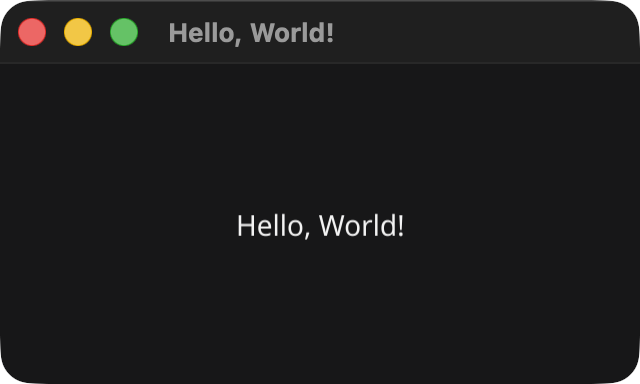

# Go · desktop: Hello, World!

> Part of [Hello World in many languages](../../../README.md) ·
> Language overview: [Go](../README.md)

## What this is
A desktop program that opens a small window titled "Hello, World!" with the
text **Hello, World!** in the middle. The window is drawn by **Fyne**, a
GUI toolkit written in Go. Go's standard library has no GUI package (unlike
Python, which ships tkinter), so Fyne is a dependency: `go.mod` names it
and `go build` downloads it.

Compare [../cli](../cli/): the program no longer prints and ends. It hands
control to Fyne's event loop, which waits for window events until you
close the window.

## Prerequisites
| Tool | Version used (macOS Intel) | Why it is needed |
|---|---|---|
| Go 1.22 or newer | Go 1.27.3 (Homebrew) | compiles the program; downloads Fyne |
| A C compiler | Apple clang 21.0.0 (Command Line Tools 26.6) | Fyne contains C code that `go build` compiles through **cgo** |
| Fyne | v2.8.2 (pinned in `go.mod`) | the GUI toolkit; downloaded by `go build`, not by `install.sh` |
| Linux only: graphics headers | not verified | OpenGL, X11, and Wayland development packages (see Platform notes) |

Fyne's README says: "you will need Go version 1.22 or later, a C compiler
and your system's development tools" [1]. Its Quick Start explains why the
C compiler is there: it is needed "to connect with system graphics
drivers" [2]. Fyne v2.8.2 was the latest release on 2026-10-31 [3].

On macOS, Fyne's Quick Start says to install Xcode and then the Command
Line Tools with `xcode-select --install` [2]. The test machine has only the
Command Line Tools (no Xcode app), and they were enough.

## Quick start
```sh
./install.sh   # check Go and the C compiler (asks before installing)
./build.sh     # download Fyne and compile into bin/hello-desktop (first time: about 1 minute)
./run.sh       # open the window; close it to end the program
```

## Scripts explained
| Script | What it does | Why it is needed |
|---|---|---|
| `install.sh` | 1. Checks for Go 1.22+ (`go env GOVERSION`). 2. Checks for a C compiler: `xcrun --find clang` on macOS, `gcc` plus the OpenGL/X11 headers on Linux, `gcc` from MSYS2 on Windows. 3. Checks that cgo is on (`go env CGO_ENABLED` is `1`). For anything missing, the script shows the install command and runs it only if you answer `y`. | Fyne needs cgo, and cgo needs a C compiler. Fyne itself is not installed here, for the same reason Maven downloads JavaFX in [../../java/desktop](../../java/desktop/): it is a library of this project, not a tool on your computer. |
| `build.sh` | Runs `go build -o bin/hello-desktop .` | The first build downloads Fyne and its dependencies into Go's module cache, checks them against `go.sum`, compiles Fyne's C code, and links one executable. "The first run has to compile some C-code and can thus take longer than usual. Subsequent builds reuse the cache and will be much faster" [2]. On the test machine, the first build took about 55 seconds. |
| `run.sh` | Runs `./bin/hello-desktop`. `--verify` sets `TF_VERIFY=1`: the app prints the label's text once it is running and quits after about 2 seconds. | The executable already contains Fyne. Only the operating system's own libraries are loaded at run time: on macOS, `otool -L bin/hello-desktop` lists Cocoa, AppKit, and OpenGL. |

`build.sh` may print `ld: warning: ignoring duplicate libraries: '-lobjc'`.
It comes from the macOS linker, is only a warning, and the program works.

## Folder structure
```text
desktop/
├── README.md        this file
├── install.sh       checks Go and the C compiler
├── build.sh         downloads Fyne and compiles
├── run.sh           opens the window
├── screenshot.png   the window, for "Expected output" below
├── go.mod           module name, minimum Go version, and the required modules (Fyne)
├── go.sum           checksums of every downloaded module
├── main.go          the program
└── bin/             created by build.sh; not committed
    └── hello-desktop
```
- The same "basic command" layout as [../cli](../cli/README.md#folder-structure):
  one `main.go` at the module root [4].
- **`go.mod`** now has `require` lines. The first, `fyne.io/fyne/v2
  v2.8.2`, is the one this program imports. The second block is marked
  `// indirect`: modules Fyne itself needs. They were written by
  `go get fyne.io/fyne/v2@v2.8.2` and `go mod tidy`, the commands Fyne's
  README shows for adding it to a project [1].
- **`go.sum`** holds a checksum for every module version. "After
  downloading a .mod or .zip file, the go command computes a cryptographic
  hash and checks that it matches a hash in the main module's go.sum
  file" [5], so every student builds with exactly the same code. Like
  `package-lock.json` in npm projects, both files are committed.
- The downloaded modules are not in this folder (unlike
  `node_modules/`): Go keeps them in one shared cache, `go env GOMODCACHE`
  (on the test machine, `~/go/pkg/mod`).

## Step-by-step walkthrough
Open [`main.go`](main.go) next to this list.

1. **`import ( ... )`** lists several packages in one block. The standard
   library ones (`fmt`, `os`, `time`) have short paths. The Fyne ones start
   with their module path, `fyne.io/fyne/v2`, which is also where Go
   downloads them from. The `/v2` is part of the path: in Go, a new major
   version of a module gets a new import path [5].
2. **`a := app.New()`** creates the application. `:=` declares a variable
   and gives it the type of the value on the right: it "is shorthand for a
   regular variable declaration with initializer expressions but no
   types" [6]. `app.New` "returns a new application instance with the
   default driver" [7].
3. **`w := a.NewWindow("Hello, World!")`** creates the window with its
   title. **`widget.NewLabel("Hello, World!")`** "creates a new label widget
   with the set text content" [7]. **`container.NewCenter(label)`** keeps it
   in the middle, like `StackPane` in [../../java/desktop](../../java/desktop/).
4. **`w.Resize(fyne.NewSize(320, 160))`** gives the window a starting size.
   Without it, the window would only be as big as the label.
5. **The self-check** (only with `TF_VERIFY=1`, used by `./run.sh --verify`):
   - `a.Lifecycle().SetOnStarted(func() { ... })` registers an anonymous
     function that Fyne calls when "the app is now running" [7]; it prints the
     label's text.
   - `go func() { ... }()` starts a **goroutine**. The spec defines the `go`
     statement as starting "the execution of a function call as an
     independent concurrent thread of control, or goroutine, within the same
     address space" [6]. It sleeps 2 seconds without blocking the window.
   - `fyne.Do(a.Quit)`: since Fyne v2.6, "all Fyne events and callbacks
     happen on the same goroutine", and "any time your app invokes Fyne APIs
     from a goroutine your code created, you should use the fyne.Do
     function" [8]. `a.Quit` closes all windows and ends the app [7].
     `a.Quit` is written without `()`: the function itself is passed, to
     be called later.
6. **`w.ShowAndRun()`** "is a shortcut to show the window and then run the
   application. This should be called near the end of a main() function as
   it will block" [7]. This is the same pattern as tkinter's `mainloop()` and
   JavaFX's `launch()`.

## Why this toolchain
- **Go has no standard GUI library**, so every Go desktop app uses a
  third-party toolkit. This repository uses Fyne.
- **Fyne's API is Go only**: the app is written without any C, HTML, or
  JavaScript. Its site says "No web runtime. No JavaScript. Just Go." and
  lists Windows, macOS, Linux, iOS, and Android as targets [9]. Its README
  describes it as "an easy-to-use UI toolkit and app API written in Go ...
  designed to build applications that run on desktop and mobile devices
  with a single codebase" [1].
- **Open source and maintained:** Fyne uses the BSD-3-Clause license [1],
  and its project published several releases in 2026, up to v2.8.2 [3].
- **Plain `go build`** is enough to build and run. Fyne also has an optional
  `fyne` tool whose `package` command makes an application bundle
  (`.app` or `.exe`) with an icon; Fyne's documentation adds: "Of course you can still run your
  applications using the standard Go tools if you prefer" [10]. A Hello World
  does not need a bundle, so the tool is not used here.

## Platform notes
| Platform | Status | Notes |
|---|---|---|
| macOS Intel | ✅ verified (2026-10-31) | Go 1.27.3, Fyne v2.8.2, Apple clang 21.0.0 (Command Line Tools only, no Xcode app). |
| macOS Apple Silicon | ⚠️ not verified | Same commands: `brew install go` and `xcode-select --install` [2]. |
| Linux (Debian/Ubuntu) | ⚠️ not verified | Fyne's Quick Start lists `sudo apt-get install golang gcc libgl1-mesa-dev xorg-dev libwayland-dev libxkbcommon-dev` [2]. `install.sh` offers the same packages except `golang`, because the distribution's Go may be older than 1.22; install Go from go.dev instead (see [../cli](../cli/README.md#platform-notes)). Fyne's page has the commands for Fedora, Arch, and other distributions [2]. |
| Windows (Git Bash / WSL) | ⚠️ not verified | Fyne recommends MSYS2: in the "MSYS2 MinGW 64-bit" shell run `pacman -Syu`, then `pacman -S git mingw-w64-x86_64-toolchain mingw-w64-x86_64-go`, and add `C:\msys64\mingw64\bin` to `PATH` [2]. Fyne's README warns: "The first compilation of Fyne on Windows can take up to 10 minutes" [1]. Executables need `.exe`: `go build -o bin\hello-desktop.exe .`. Under WSL, a window needs WSLg or an X server. |

## Expected output
`./run.sh` opens this window (on the test machine, macOS was in dark mode,
and the window used the dark theme too):



(Taken on 2026-10-31 on macOS Intel with `screencapture -x -o -l <window-id> screenshot.png`,
which captures only that window.)

`./run.sh --verify` prints:
```text
==> Open the Hello World window
    WHY: Fyne, linked into bin/hello-desktop, opens the window and draws it with OpenGL.
    Self-check: the app prints the label text and closes after ~2 seconds.
Hello, World!
```

## Sources
1. `fyne-io/fyne` (README, license). GitHub. <https://github.com/fyne-io/fyne> (accessed 2026-10-31)
2. Getting Started (Quick Start: prerequisites per OS, first build). Fyne. <https://docs.fyne.io/started/quick/> (accessed 2026-10-31)
3. Releases. `fyne-io/fyne` (GitHub).
 <https://github.com/fyne-io/fyne/releases> (accessed 2026-10-31)
4. Organizing a Go module. The Go Authors. <https://go.dev/doc/modules/layout> (accessed 2026-10-31)
5. Go Modules Reference (major version suffixes, go.sum). The Go Authors. <https://go.dev/ref/mod> (accessed 2026-10-31)
6. The Go Programming Language Specification (Short variable declarations, Go statements). The Go Authors. <https://go.dev/ref/spec> (accessed 2026-10-31)
7. Fyne v2.8.2 API: app.New, App, Window, Lifecycle, widget.NewLabel. pkg.go.dev. <https://pkg.go.dev/fyne.io/fyne/v2@v2.8.2> (accessed 2026-10-31; also read with `go doc` from the downloaded module)
8. Goroutines and threading. Fyne. <https://docs.fyne.io/started/goroutines/> (accessed 2026-10-31)
9. Fyne home page. Fyne. <https://fyne.io/> (accessed 2026-10-31)
10. Packaging for desktop. Fyne. <https://docs.fyne.io/started/packaging/> (accessed 2026-10-31)
