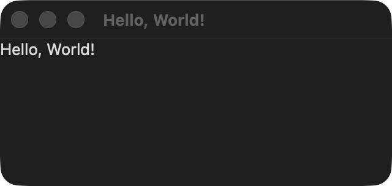

# Kotlin · desktop: Hello, World!

> Part of [Hello World in many languages](../../../README.md) ·
> Language overview: [Kotlin](../README.md)

## What this is
A desktop program that opens a native window titled **Hello, World!** with
the text **Hello, World!** inside. It uses **Compose Multiplatform**, "an
open-source, declarative UI framework developed by JetBrains for building
shared UIs across Android, iOS, desktop, and web with Kotlin" [1]. Gradle
builds and runs it. For the same task with Java toolkits, see
[JavaFX](../../java/desktop/) and [Swing](../../java/desktop-swing/).

## Prerequisites
| Tool | Version used (macOS Intel) | Why it is needed |
|---|---|---|
| JDK (Java Development Kit) 21 or newer | Eclipse Temurin 21.0.8 | Gradle and the program run on the JVM |
| Gradle | 9.8.0 | the build tool: reads `build.gradle.kts`, downloads the dependencies, compiles and starts the program |
| Kotlin Gradle plugin | 2.4.21 (pinned in `build.gradle.kts`) | compiles the Kotlin code; **not installed by hand**: Gradle downloads it during `./build.sh` |
| Compose Multiplatform | 1.12.2 (pinned in `build.gradle.kts`) | the UI libraries and the `run` task; downloaded by Gradle |
| Kotlin Compose compiler plugin | 2.4.21 (pinned) | rewrites the `@Composable` functions; downloaded by Gradle |

Gradle "requires Java Development Kit (JDK) version 17 or higher to run"
[3]. Kotlin Gradle plugin 2.4.21 supports Gradle 7.6.3 to 9.7.0 fully, and
the same page says that newer Gradle versions work but "you might encounter
deprecation warnings" [4]. Gradle 9.8.0 is newer than 9.7.0, and the build
prints one such warning (about Gradle 10). It still builds and runs.

## Quick start
```sh
./install.sh   # check / install the JDK and Gradle (asks before installing)
./build.sh     # download the dependencies and compile (a few minutes the first time)
./run.sh       # open the window; close it to end the program
```

## Scripts explained
| Script | What it does | Why it is needed |
|---|---|---|
| `install.sh` | 1. Checks that `java` is version 21 or newer. 2. Checks that `gradle` is on `PATH`. If one is missing, it shows the install command (on macOS `brew install gradle` [3]) and runs it only if you answer `y`. | The same JDK as [../cli](../cli/README.md#scripts-explained). This repository does not commit the Gradle wrapper, which is a jar plus scripts that download Gradle [3], so Gradle is installed once instead. |
| `build.sh` | Runs `gradle --no-daemon --console=plain classes`. | The `classes` task downloads the plugins and libraries, then compiles `Main.kt`. `--no-daemon` stops the Gradle background process at the end of the build. |
| `run.sh` | Runs `gradle --no-daemon --quiet --console=plain run`. `--verify` sets `TF_VERIFY=1` first. | The Compose Gradle plugin provides the `run` task, which starts the main class [5]. With `TF_VERIFY=1` the program prints `Hello, World!` once its window is shown and closes itself after about 2 seconds, so `scripts/verify-all.sh` does not wait for you. |

## Folder structure
```text
desktop/
├── README.md                    this file
├── install.sh                   checks / installs the JDK and Gradle
├── build.sh                     compiles with Gradle
├── run.sh                       runs the program (gradle run)
├── screenshot.png               the window, for "Expected output" below
├── settings.gradle.kts          project name and where Gradle finds plugins and libraries
├── build.gradle.kts             plugins, dependencies and the main class
├── .gitignore                   keeps build/, .gradle/ and .kotlin/ out of the repository
├── src/main/kotlin/
│   └── Main.kt                  the whole program
├── build/                       created by Gradle; not committed
├── .gradle/                     created by Gradle; not committed
└── .kotlin/                     created by the Kotlin plugin; not committed
```
- `build.gradle.kts` is a build script written in Kotlin (`.kts`). The
  Kotlin documentation says: "To target the JVM, apply the Kotlin JVM
  plugin" [4]. `implementation(compose.desktop.currentOs)`
  adds the Compose libraries for the operating system that runs the build,
  and `mainClass = "MainKt"` names the class that Kotlin generates for
  `Main.kt` [5].

## Step-by-step walkthrough
Open [`Main.kt`](src/main/kotlin/Main.kt) next to this list.

1. **Imports** name Compose functions such as `Window` and `Text`. Kotlin
   imports functions directly because they can live outside classes; Java
   imports only classes.
2. **`fun main() = application { ... }`** is the entry point, again a
   top-level function with no class ([cli walkthrough](../cli/README.md#step-by-step-walkthrough)).
   `=` means the function body is one expression. `application` starts
   Compose and keeps the program running until `exitApplication()` is
   called. [JavaFX](../../java/desktop/README.md) needs a subclass of
   `Application`, and Swing needs a call to `invokeLater`.
3. **`val verify = System.getenv("TF_VERIFY") == "1"`** reads the
   environment variable. `val` declares a variable that cannot be assigned
   again, the type is inferred, and `==` compares text by content (Java uses
   `equals`). A Kotlin program calls Java library methods such as
   `System.getenv` directly, because Kotlin is "100% interoperable with the
   Java programming language" [2].
4. **`Window(onCloseRequest = ::exitApplication, title = "Hello, World!") { ... }`**
   opens a native window. The arguments are named, and `::exitApplication`
   is a reference to a function. The block in braces, a trailing lambda, is
   the content of the window.
5. **`Text("Hello, World!")`** is a *composable function*: it describes a
   piece of the screen instead of creating a label object and changing it
   later. This is the declarative style that Compose Multiplatform is built
   on [1].
6. **`LaunchedEffect(Unit) { ... }`**, used only with `TF_VERIFY=1`, runs
   its block once, after the window is composed. It runs in a coroutine, so
   `delay(2000)` pauses for two seconds without freezing the window. Then
   the program calls `exitApplication()`.

## Why this toolchain
- **Compose Multiplatform is JetBrains' UI framework for Kotlin.** It runs on
  desktop for "Windows, macOS, and Linux from one codebase" [1].
- **It shares its API with Android.** "Compose Multiplatform shares its API
  with Jetpack Compose" [1], Google's UI framework for Android, so a
  reader who learns one learns the other. The [language overview](../README.md)
  explains why Android matters for Kotlin.
- **Version 1.12.2** is the newest release without a pre-release tag on the
  Gradle plugin portal on 2026-11-04. The portal also lists 1.13.0-beta02,
  which this folder does not use [6].
- **Gradle** is the build tool that the Compose Multiplatform plugin is made
  for: its `run` task is a Gradle task [5].

## Platform notes
| Platform | Status | Notes |
|---|---|---|
| macOS Intel | ✅ verified (2026-11-04) | macOS 26, Temurin 21.0.8, Gradle 9.8.0, Kotlin 2.4.21, Compose Multiplatform 1.12.2. First build downloads the dependencies (37 s for `./build.sh` on the verification machine). |
| macOS Apple Silicon | ⚠️ not verified | Same commands. `compose.desktop.currentOs` picks the Apple Silicon libraries by itself. |
| Linux (Debian/Ubuntu) | ✅ verified in CI (2026-11-06) | GitHub Actions `ubuntu-latest` (Ubuntu 26.04, x86_64). `install.sh` installs `openjdk-21-jdk` with apt when no Java 21 is found. It does not install Gradle: if it is missing it prints how to get a current one [3] and stops. The window opens on a virtual X display (Xvfb). |
| Windows (Git Bash / WSL) | ✅ verified in CI (2026-11-06) | GitHub Actions `windows-latest` (Windows Server 2025), Git Bash. `install.sh` puts the JDK from `JAVA_HOME_21_X64` on PATH when that variable is set. It does not install a JDK: if Java 21 is missing it prints the `winget` Temurin 21 command and stops. It does not install Gradle either: if it is missing it prints `winget install --id Gradle.Gradle -e` [3] and stops. WSL not verified; it behaves like Linux. |

## Expected output
`./run.sh` opens a window titled "Hello, World!" with the text in its
top-left corner:



(Taken on 2026-11-04 on macOS Intel with `screencapture -x -o -l <window-id> screenshot.png`,
which captures only that window. The window follows the macOS appearance
setting; this one was captured in dark mode.)

`./run.sh --verify` prints:
```text
==> Open the Hello World window
    WHY: Compose Multiplatform draws the window; 'gradle run' starts it.
    Self-check: the app prints Hello, World! and closes after about 2 seconds.
Hello, World!
```
The last line comes from the program and the command ends with exit code 0.

## Sources
1. Compose Multiplatform. JetBrains. <https://kotlinlang.org/compose-multiplatform/> (accessed 2026-11-04)
2. Kotlin FAQ (Java interoperability). JetBrains. <https://kotlinlang.org/docs/faq.html> (accessed 2026-11-04)
3. Installing Gradle. Gradle. <https://docs.gradle.org/current/userguide/installation.html> (accessed 2026-11-04)
4. Configure a Gradle project (Kotlin Gradle plugin, compatibility, `kotlin("jvm")`). JetBrains. <https://kotlinlang.org/docs/gradle-configure-project.html> (accessed 2026-11-04)
5. Compose Multiplatform desktop template (README and `build.gradle.kts`; archived 2025-07-14). JetBrains. <https://github.com/JetBrains/compose-multiplatform-desktop-template> (accessed 2026-11-04)
6. org.jetbrains.compose Gradle plugin, version list. Gradle Plugin Portal. <https://plugins.gradle.org/m2/org/jetbrains/compose/org.jetbrains.compose.gradle.plugin/maven-metadata.xml> (accessed 2026-11-04)
