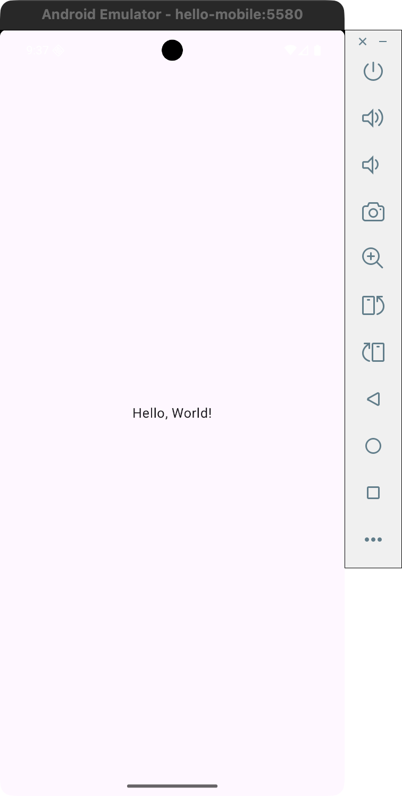

# Kotlin · mobile-android: Hello, World!

> Part of [Hello World in many languages](../../../README.md) ·
> Language overview: [Kotlin](../README.md)

## What this is
An Android app that shows **Hello, World!** on the screen of an Android
device. The screen is built with **Jetpack Compose**, "Android's modern
toolkit for building native UI" [1]. The Android Gradle plugin builds the
app, and the **emulator** runs it on the computer, so no phone is needed.
`./run.sh --verify` checks that the app's screen is on top and that the text
is on the screen. For the same task on a desktop, see the
[Compose desktop](../desktop/README.md) version, which uses the same language
and UI library on a different platform.

## Prerequisites
| Tool | Version used (macOS Intel) | Why it is needed |
|---|---|---|
| JDK (Java Development Kit) 21 or newer | Eclipse Temurin 21.0.8 | the Android Gradle plugin 9.5.1 needs JDK 17 or newer [2]; 21 is the version the other Kotlin folders use |
| Gradle | 9.8.0 (9.6.0 or newer is required) | the build tool; the Android Gradle plugin 9.5.1 needs Gradle 9.6.0 or newer [2] |
| Android Gradle plugin (AGP) | 9.5.1 (pinned in `build.gradle.kts`) | compiles the app and makes the APK; Gradle downloads it [2] |
| Kotlin | built into AGP 9, not installed by hand | AGP 9 has built-in Kotlin support, so the Kotlin Android plugin must not be applied [2] |
| Jetpack Compose | BOM 2026.09.00 (pinned) | the UI library; the bill of materials sets the versions of its libraries [3] |
| Android SDK command-line tools | build 15859902 | `sdkmanager` installs the SDK packages and `avdmanager` creates the emulator device [4] |
| Android SDK Platform, Build-Tools | Android 37.0 (`android-37.0`), build-tools 37.0.0 | the Android APIs that the app compiles against, and the tools that package it; Compose 1.12 and later need `compileSdk 37` [3][4] |
| Android Emulator | 37.2.13 | runs the virtual device on the computer [5] |
| System image | `google_apis` `x86_64`, Android 36 | the Android software that the emulator runs; the Intel CPU type matches an Intel Mac. The Android 37.0 image did not boot on the development machine (the device stayed `offline`, blank window), so the device runs Android 36 while the app still compiles against 37 [5] |

### Disk and time cost
The Android SDK and the emulator are the largest parts of this folder. The
measurements below come from a fresh install on the development machine
(macOS Intel, 2026-11-11). Your numbers depend on your network and disk.

| Item | Size on disk | Time |
|---|---|---|
| Android SDK packages (the folder `ANDROID_HOME`, default `~/.local/android-sdk`) | <<SDK_SIZE>> | <<SDK_TIME>> |
| Emulator device (AVD) `hello-mobile` | <<AVD_SIZE>> | <<AVD_TIME>> |
| Gradle cache with AGP and the Compose libraries (`~/.gradle`) | <<GRADLE_SIZE>> | first `./build.sh`: <<BUILD_TIME>> |
| First boot of the emulator | | <<BOOT_TIME>> |
| Later boots and later builds | | a few minutes, mostly the boot |

The system image is the largest single package. You need about
<<TOTAL_GB>> GB of free disk space for everything above.

If you already have an Android SDK, for example from Android Studio, set
`ANDROID_HOME` to its folder before you run `./install.sh`. The script then
uses that SDK and downloads only what is missing.

## Quick start
```sh
./install.sh   # check, and install after you answer y: JDK, Gradle, the SDK and the emulator device
./build.sh     # download AGP and the libraries, then build app-debug.apk (minutes the first time)
./run.sh       # start the emulator, install the app and open it; the emulator window stays open
```

## Scripts explained
| Script | What it does | Why it is needed |
|---|---|---|
| `install.sh` | Checks the JDK, Gradle, the command-line tools, the SDK packages, hardware acceleration and the emulator device `hello-mobile`. Downloads the command-line tools only on macOS, checks their SHA-256 checksum before it unpacks them, and asks before every download or license acceptance. | The steps are listed in the script, with the reason for each one. Nothing is downloaded or accepted without your answer, and `sudo` is never run. |
| `build.sh` | Runs `gradle --no-daemon --console=plain assembleDebug`. | `assembleDebug` compiles `MainActivity.kt`, merges the manifest, and signs the APK with the debug key. `--no-daemon` ends the Gradle background process with the build. The first build downloads the Gradle plugins and libraries named in the build files into Gradle's cache (`~/.gradle`); later builds reuse them. |
| `run.sh` | Runs `build.sh`, starts the emulator if none is running, waits until Android has booted, installs the APK with `adb install -r`, and starts the activity with `adb shell am start -W`. | The emulator is the device the app runs on. `adb` talks to it. With `--verify` the emulator has no window, the script checks the screen, and it stops the emulator it started. |
| `android-env.sh` | Sets `ANDROID_HOME`, the package versions, the emulator name and the checksums. It is sourced by the other three scripts. | The platform, build-tools and system image must belong to the same Android version. One file keeps them in step. |

`run.sh --verify` is the self-check that `scripts/verify-all.sh` runs. It
prints the text that the uiautomator dump found on the screen:
```text
==> 5/5 Check the screen
[ok] The activity com.example.hello/.MainActivity is on top of the screen.
[ok] The text is on the screen:
Hello, World!
```

## Folder structure
```text
mobile-android/
├── README.md                    this file
├── install.sh                   checks, and installs after you answer y, the Android tools
├── build.sh                     builds the debug APK with Gradle
├── run.sh                       builds, starts the emulator, installs and opens the app
├── android-env.sh               SDK folder, versions, emulator name and checksums (sourced)
├── screenshot.png               the emulator window, for "Expected output" below
├── settings.gradle.kts          project name, the module list, where Gradle finds plugins
├── build.gradle.kts             the root build file: declares the plugin versions
├── gradle.properties            settings for every Gradle build
├── .gitignore                   keeps build/, .gradle/ and local.properties out of the repository
├── app/
│   ├── build.gradle.kts         the app: SDK levels, Compose, the libraries it uses
│   └── src/main/
│       ├── AndroidManifest.xml  the app's description: its name and its start screen
│       └── java/com/example/hello/
│           └── MainActivity.kt  the whole program: one screen with the text
├── build/                       created by Gradle and run.sh; not committed
├── .gradle/                     created by Gradle; not committed
└── .kotlin/                     created by the Kotlin compiler; not committed
```
- The Kotlin sources are in `app/src/main/java/`, the same folder that Java
  sources use in an Android project. The build compiled `MainActivity.kt`
  from it without extra settings (checked 2026-11-11). The package
  `com.example.hello` is the folder path `com/example/hello/`.
- `AndroidManifest.xml` is the file Android reads before it runs any code.
  It names the activity that opens first [6].
- `build.gradle.kts` files are written in Kotlin (`.kts`), as in the
  [desktop](../desktop/README.md) version. Android projects also have XML
  files, such as the manifest, because Android reads them at install time.

## Step-by-step walkthrough
Open [`MainActivity.kt`](app/src/main/java/com/example/hello/MainActivity.kt)
next to this list.

1. **`class MainActivity : ComponentActivity()`** declares the screen. An
   activity is "one screen" of an Android app [6]. The colon is Kotlin's
   syntax for "extends"; Java writes `extends`.
2. **`override fun onCreate(savedInstanceState: Bundle?)`** runs when the
   screen is created. `override` says that the function replaces the one of
   the base class. `Bundle?` ends in a question mark because the saved state
   is `null` the first time the screen opens.
3. **`setContent { ... }`** receives the screen as a function. The braces
   describe what the screen shows. In the XML views of a Java app, the same
   screen is an XML layout that `setContentView` loads.
4. **`MaterialTheme { Surface { Box { Text("Hello, World!") } } }`** nests
   the composable functions. `MaterialTheme` sets the colors and fonts, and
   follows the light or dark setting of the device. `Surface` fills the
   screen with the background color, and `Box` centers its child.
5. **`Text("Hello, World!")`** is the text on the screen. It is a function
   call with one argument. `run.sh --verify` looks for exactly this text in
   the screen's view tree.
6. **`AndroidManifest.xml`** says that `.MainActivity` starts when the user
   taps the icon (the `LAUNCHER` category). The `label` is the name under
   the icon.
7. **`build.gradle.kts`** names the SDK levels. `compileSdk = 37` is the
   Android API the code compiles against, and `minSdk = 24` is the oldest
   Android that can install the app [3][4]. `compose = true` turns on the
   Compose compiler for this module.

## Why this toolchain
- **Jetpack Compose is the recommended UI toolkit.** The Android Developers
  site says: "Jetpack Compose is Android's recommended modern toolkit for
  building native UI" [1]. Compose 1.0 was announced on 28 July 2021, and
  the announcement says: "It's stable, and ready for you to adopt in
  production" [7].
- **Kotlin is the language Google recommends for Android.** At Google I/O
  2019, Google wrote: "Android development will become increasingly
  Kotlin-first" [8]. The [language overview](../README.md) gives the dates
  and the other sources.
- **The emulator needs no phone.** The emulator runs Android system images
  on the computer [5].

## Platform notes
| Platform | Status | Notes |
|---|---|---|
| macOS Intel | ✅ verified (2026-11-11) | macOS 26.7.2, Temurin 21.0.8, Gradle 9.8.0, AGP 9.5.1, Android 36 emulator image (compiled against 37.0). The emulator uses Hypervisor.Framework [5]. |
| macOS Apple Silicon | ⚠️ not verified | The scripts download the arm64 command-line tools zip, and the system image must be the arm64 one. The image name in `android-env.sh` is for Intel and must change. |
| Linux (Debian/Ubuntu) | ⚠️ not verified | No runner was used for this check, so the scripts are not run there. `install.sh` stops before download and prints the steps. Hardware acceleration on Linux uses KVM, which must be enabled [5]. |
| Windows (Git Bash / WSL) | ⚠️ not verified | `install.sh` stops before download and prints the steps. The Windows emulator needs a hypervisor [5]. WSL is not verified. |

This folder is not verified in continuous integration (CI): the Linux and
Windows CI workflow has no Android emulator. The checks are the ones on the
development machine.

## Expected output
`./run.sh` opens the emulator window, and the app shows **Hello, World!** in
the middle of the screen:



(Taken on 2026-11-13 on macOS Intel with `screencapture -x -o -l <window-id> screenshot.png`,
which captures only the emulator window. The window ID comes from the
`CGWindowListCopyWindowInfo` list for the window titled "Android Emulator".)

**Slow or blank window?** The emulator draws the screen with the CPU when it has
a window, and a busy Mac makes that slow. The first boot of a new device is the
slowest, because Android compiles its apps then. If the window stays black, give
it a few minutes. If it shows "System UI isn't responding", tap **Wait**, then
run `adb shell am start -W -n com.example.hello/.MainActivity` to open the app
again. Close other heavy programs first. This was seen on the development
machine while other builds were running.

`./run.sh --verify` ends with this output:
```text
==> 5/5 Check the screen
    WHY: --verify checks two things. ...
[ok] The activity com.example.hello/.MainActivity is on top of the screen.
[ok] The text is on the screen:
Hello, World!
```
The last line comes from the script, and the command ends with exit code 0.

## Sources
1. Jetpack Compose. Android Developers. <https://developer.android.com/jetpack/compose> (accessed 2026-11-11)
2. Android Gradle plugin release notes and built-in Kotlin. Android Developers. <https://developer.android.com/build/releases/gradle-plugin> and <https://developer.android.com/build/releases/past-releases/agp-9-0-0-release-notes> (accessed 2026-11-11). Maven metadata for the version: <https://dl.google.com/dl/android/maven2/com/android/tools/build/gradle/maven-metadata.xml> (accessed 2026-11-11)
3. Set up Compose: dependencies, the Compose compiler plugin and the BOM. Android Developers. <https://developer.android.com/develop/ui/compose/setup-compose-dependencies-and-compiler> (accessed 2026-11-11). The BOM version: <https://dl.google.com/dl/android/maven2/androidx/compose/compose-bom/maven-metadata.xml> (accessed 2026-11-11)
4. Android Studio downloads, command-line tools only. Android Developers. <https://developer.android.com/studio#command-line-tools-only> (accessed 2026-11-11). sdkmanager. <https://developer.android.com/tools/sdkmanager> (accessed 2026-11-11). avdmanager. <https://developer.android.com/tools/avdmanager> (accessed 2026-11-11)
5. Run Android Emulator on the command line. Android Developers. <https://developer.android.com/studio/run/emulator-commandline> (accessed 2026-11-11)
6. App manifest overview and the activity element. Android Developers. <https://developer.android.com/guide/topics/manifest/manifest-intro> (accessed 2026-11-11)
7. Jetpack Compose is now 1.0: announcing Android's modern toolkit for building native UI. Android Developers Blog, 2021-07-28. <https://android-developers.googleblog.com/2021/07/jetpack-compose-announcement.html> (accessed 2026-11-11)
8. Google I/O 2019: Empowering developers to build the best experiences on Android + Play. Android Developers Blog, 2019-05-07. <https://android-developers.googleblog.com/2019/05/google-io-2019-empowering-developers-to-build-experiences-on-Android-Play.html> (accessed 2026-11-22)
