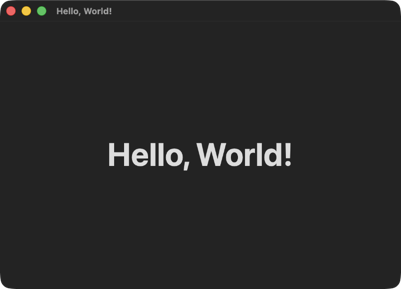

# Objective-C · desktop: Hello, World!

> Part of [Hello World in many languages](../../../README.md) ·
> Language overview: [Objective-C](../README.md)

## What this is
A macOS desktop application that opens a window showing "Hello, World!"
in bold text. Built with AppKit, the traditional macOS GUI framework.

## Prerequisites
| Tool | Version used (macOS Intel) | Why it is needed |
|---|---|---|
| Clang | 21.0.0 (Apple clang) | Compiles Objective-C source with AppKit |
| AppKit framework | macOS system | Provides NSWindow, NSTextField and GUI controls |

## Quick start
```sh
./install.sh   # check the toolchain
./build.sh     # compile hello.m → hello
./run.sh       # open the window
```

## Scripts explained
| Script | What it does | Why it is needed |
|---|---|---|
| `install.sh` | Checks `clang` with Objective-C support and that macOS is available | AppKit requires Apple platform SDKs; it does not run on Linux or Windows |
| `build.sh` | Runs `clang hello.m -o hello -framework Cocoa` | Compiles the AppKit app into a Mach-O executable linked against Cocoa |
| `run.sh` | Runs `./hello` (opens window); `--verify` sets `TF_VERIFY=1`, so the app also prints the label text and closes after about 2 seconds | The self-check runs the same window code and ends on its own |

## Folder structure
```text
desktop/
├── README.md      this file
├── install.sh     checks the Clang toolchain and macOS
├── build.sh       compiles hello.m
├── run.sh         runs the program
├── screenshot.png the window, for "Expected output" below
└── hello.m        the AppKit source code
```
Layout reference: [AppKit framework](https://developer.apple.com/documentation/appkit)

## Step-by-step walkthrough

1. **`#import <Cocoa/Cocoa.h>`** — imports the Cocoa umbrella header, which
   includes both Foundation and AppKit. Cocoa is the macOS application
   framework suite. Compare with Swift's `import Cocoa` or Java's
   `import javax.swing.*`.

2. **`NSApplication *app = [NSApplication sharedApplication]`** — gets the
   shared application instance. `NSApplication` manages the event loop,
   menus, windows and the connection to the macOS window server. Compare
   with Java's `Application.launch()` or C++ Qt's `QApplication`.

3. **`[app setActivationPolicy:NSApplicationActivationPolicyRegular]`** —
   sets the app to appear in the Dock and be activatable. Without this,
   the app runs in the background without a Dock icon. Compare with
   Electron's `app.whenReady()` or Swift's `@main`.

4. **`NSWindow *window = [[NSWindow alloc] initWithContentRect:...]`** —
   creates a window with the specified rectangle and style. The style mask
   includes title bar, close button, resize capability and minimize button.
   Compare with Java's `JFrame` or Python's `tk.Tk()`.

5. **`[window setTitle:@"Hello, World!"]`** — sets the window title bar text.
   Compare with HTML's `<title>` or Java's `frame.setTitle()`.

6. **`NSTextField *label = [[NSTextField alloc] initWithFrame:...]`** —
   creates a text field (label) positioned within the window. The frame
   specifies x, y, width and height in points. Compare with HTML's
   `<div>` or Java's `JLabel`.

7. **`[label.setFont:[NSFont boldSystemFontOfSize:48]]`** — sets the label's
   font to the system bold font at 48 points. `NSFont` provides access to
   all fonts installed on the system. Compare with CSS's `font-weight: bold;
   font-size: 48px`.

8. **`[[window contentView] addSubview:label]`** — adds the label as a
   subview of the window's content view. AppKit uses a view hierarchy:
   each view can contain subviews. Compare with HTML's DOM tree or
   Java's `frame.add(label)`.

9. **`[app run]`** — starts the application event loop. This blocks until
   the last window is closed. The event loop processes mouse clicks,
   keyboard input, timer events and window management. Compare with
   Python's `root.mainloop()` or JavaFX's `stage.show()`.

## Why this toolchain
AppKit is the traditional macOS GUI framework, dating back to NeXTSTEP in
the 1980s. It provides a comprehensive set of classes for building native
macOS applications. While SwiftUI is Apple's modern alternative, AppKit
remains the foundation for macOS development and is used extensively in
existing codebases.

On Linux, [GNUstep] provides a compatible AppKit implementation (GNUstep
GUI), but it is not verified on this machine.

Source: [AppKit — developer.apple.com](https://developer.apple.com/documentation/appkit)

## Platform notes
| Platform | Status | Notes |
|---|---|---|
| macOS Intel | ✅ verified (2026-11-19) | Clang 21.0.0, AppKit via Xcode CLI tools |
| macOS Apple Silicon | ⚠️ not verified | Same commands; AppKit is native on Apple Silicon |
| Linux (Debian/Ubuntu) | ⚠️ not verified | Requires GNUstep; `sudo apt install gnustep-devel` |
| Windows (Git Bash / WSL) | ⚠️ not verified | Requires GNUstep through WSL |

## Expected output
A macOS window (600×400) titled "Hello, World!" showing "Hello, World!" in
bold 48pt text. The text uses the system label color, so it is dark on a
light window and light on a dark one; the screenshot was taken in dark mode.



(Taken on 2026-11-19 on macOS Intel with `screencapture -x -o -l <window-id> screenshot.png`,
which captures only that window. It needs the Screen & System Audio
Recording permission in System Settings → Privacy & Security.)

## Sources
1. AppKit documentation. Apple Inc. [developer.apple.com/documentation/appkit](https://developer.apple.com/documentation/appkit) (accessed 2026-11-06)
2. What Is Cocoa? Apple Inc. [developer.apple.com/library/archive](https://developer.apple.com/library/archive/documentation/Cocoa/Conceptual/CocoaFundamentals/WhatIsCocoa/WhatIsCocoa.html) (accessed 2026-11-17)
3. Objective-C Programming Language. Apple Inc. [developer.apple.com/library/archive/documentation/Cocoa/Conceptual/ProgrammingWithObjectiveC](https://developer.apple.com/library/archive/documentation/Cocoa/Conceptual/ProgrammingWithObjectiveC/Introduction/Introduction.html) (accessed 2026-11-06)
4. GNUstep — Open-source Cocoa. [GNUstep](https://www.gnustep.org/) (accessed 2026-11-06)
