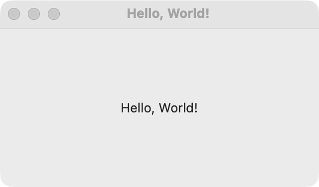

# Pascal · desktop: Hello, World!

> Part of [Hello World in many languages](../../../README.md) ·
> Language overview: [Pascal](../README.md)

## What this is
A desktop program that opens a small window titled "Hello, World!" with
the text **Hello, World!** in the middle. It is a **Lazarus** project:
Lazarus is "a Delphi compatible cross-platform IDE for Free Pascal" that
"includes LCL which is more or less compatible with Delphi's VCL" [1]. The
LCL, the "Lazarus component library", "contains platform independent visual
components" [2]: the same code draws a native Cocoa window on macOS, a
Win32 window on Windows and a GTK or Qt window on Linux.

The project is built from the command line with **lazbuild**, the build
tool of Lazarus, so you do not need to open the IDE. The code is **Object
Pascal** (Free Pascal's `objfpc` mode), not the ISO Standard Pascal of
[../cli](../cli/); see [Comparing with the cli](#comparing-with-the-cli).

## Prerequisites
| Tool | Version used (macOS Intel) | Why it is needed |
|---|---|---|
| Free Pascal (`fpc`) | 3.2.2, official macOS release in `~/.local/fpc-3.2.2` (as in [../cli](../cli/README.md#prerequisites)) | compiles the Pascal units and links the program |
| lazbuild + LCL | Lazarus 4.8, built from the official source release into `~/.local/lazarus-4.8` by `install.sh` | builds the project and provides the GUI library |
| Apple's linker and `make` | Command Line Tools (Apple clang 21.0.0) | FPC links with the system linker; `make` builds lazbuild |

**Why Lazarus is built from source on macOS.** Homebrew's `lazarus` cask
is disabled since 2026-01-27 (it "no longer meets the criteria for
acceptable casks"; its last version was 3.6) [3]. The official Lazarus macOS
download for 4.8 is a zip with the prebuilt IDE, published next to a Free
Pascal **3.2.4 release candidate** (`fpc-3.2.4rc1a.intelarm64-macosx.dmg`)
[17]. This project uses the stable FPC 3.2.2 in both folders and only needs
lazbuild, not the IDE. Lazarus can be built from its source release
with `make`. Its README gives `make clean bigide` for the full IDE [2],
and its `Makefile.fpc` has a separate, smaller `lazbuild` target, the first
step of `bigide` [5], which is all this project needs. The script
`install.sh` therefore:

1. installs Free Pascal 3.2.2 if it is missing, as in
   [../cli](../cli/README.md#prerequisites) (Homebrew's `fpc` does not build on
   Intel Macs);
2. downloads `lazarus-4.8-0.tar.gz` from SourceForge, where the Lazarus
   team publishes its releases [6], and checks its SHA-256 (computed from
   the file whose MD5 matches the one SourceForge lists, see
   `lazarus-env.sh`);
3. unpacks it into `~/.local/lazarus-4.8` and runs `make lazbuild` there.

No `sudo`: everything goes into your home folder. Delete
`~/.local/lazarus-4.8` (and `~/.local/fpc-3.2.2`) to uninstall. On the dev
machine, the whole `install.sh` took about 3 minutes from scratch, with the
downloads already cached (2026-11-01).

Lazarus 4.8 (2026-06-11) is the latest stable release; 5.0 is at release
candidate 1 [7].

## Quick start
```sh
./install.sh   # check / install Free Pascal and lazbuild (asks before installing)
./build.sh     # lazbuild hello.lpi -> bin/hello-desktop (first time: also compiles the LCL)
./run.sh       # open the window; close it to end the program
```

## Scripts explained
| Script | What it does | Why it is needed |
|---|---|---|
| `fpc-env.sh` | Same file as in [../cli](../cli/): Free Pascal version, checksum and folder; puts `~/.local/fpc-3.2.2/bin` on `PATH` when FPC is installed there. | Each implementation folder stays independent. |
| `lazarus-env.sh` | Sets `LAZARUS_VERSION`, `LAZARUS_SHA256`, `LAZARUS_DIR` (default `~/.local/lazarus-4.8`) and picks the lazbuild command: `$LAZARUS_DIR/lazbuild` with `--lazarusdir` and `--pcp` if it exists, otherwise `lazbuild` from `PATH`. | One place for the Lazarus version and folder. `--pcp` ("Primary config directory where Lazarus stores its config files", default `~/.lazarus` [8]) keeps the settings of this Lazarus installation apart from any other Lazarus installation. |
| `install.sh` | 1. Checks `fpc`. 2. Checks `lazbuild`. If missing on macOS: the steps above. On Debian/Ubuntu: `sudo apt-get install -y fpc` and `sudo apt-get install -y lazarus`. On Windows: prints the Lazarus installer link. Everything runs only if you answer `y`. | Standard Pascal has no windows; the LCL comes with Lazarus. |
| `build.sh` | Runs `lazbuild hello.lpi` (plus the options from `lazarus-env.sh`) and prints the command. `LCL_WS=qt5 ./build.sh` passes `--ws=qt5` to select another widgetset. | lazbuild knows the whole project: units, form file, the LCL package, the output path. |
| `run.sh` | Runs `./bin/hello-desktop`. With `--verify` it sets `TF_VERIFY=1`: the app prints the label text once the window is shown and closes itself after 2 seconds. | The executable is machine code. `--verify` lets `scripts/verify-all.sh` check a GUI program without human interaction. |

**What `lazbuild hello.lpi` does.** Its help text: "lazbuild [options]
<project/package filename or package name>" [8]. It reads `hello.lpi`,
sees that the project needs the `LCL` package, compiles the LCL and the
packages under it for the chosen widgetset if they are not compiled yet
(about 280 units on the first build; 50 seconds on the dev machine), then
calls `fpc` for `hello.lpr` and `mainunit.pas` and links
`bin/hello-desktop`. Later builds only recompile what changed.

**Which widgetset?** `--ws` is optional: "Override the project widgetset
... Default: cocoa" on macOS [8]. In Lazarus 4.8 the default is `win32` on
Windows, `cocoa` on macOS and `gtk2` on other systems such as Linux [9].

## Folder structure
```text
desktop/
├── README.md        this file
├── fpc-env.sh       Free Pascal version, checksum and folder (sourced)
├── lazarus-env.sh   Lazarus version, checksum, folder, lazbuild command (sourced)
├── install.sh       checks / installs Free Pascal and lazbuild
├── build.sh         lazbuild hello.lpi
├── run.sh           runs bin/hello-desktop
├── hello.lpi        Lazarus project information (XML): units, LCL dependency, output path
├── hello.lpr        Lazarus program: the main program, starts the application
├── mainunit.pas     the form (window) class and its event handlers
├── mainunit.lfm     the form's description: size, title, label, timer
├── screenshot.png   the window on macOS (used below)
├── bin/             created by build.sh; not committed (see ../../../.gitignore)
│   └── hello-desktop
└── lib/x86_64-darwin/   compiled units (.o, .ppu); not committed
```
This is the layout the Lazarus IDE creates for a new "Application"
project: a `.lpi` project file, a `.lpr` main program, and one `.pas` +
`.lfm` pair per form. You can open `hello.lpi` in the Lazarus IDE (if you
install it) and see the same window in the form designer.

## Step-by-step walkthrough
Open the files next to this list.

1. **`hello.lpi`** is XML that Lazarus normally writes for you. The parts
   that matter: `RequiredPackages` lists `LCL`; `Units` lists `hello.lpr`
   and `mainunit.pas` (with its form `MainForm`); `Target/Filename` is
   `bin/hello-desktop`; `UnitOutputDirectory` is
   `lib/$(TargetCPU)-$(TargetOS)`.
2. **`hello.lpr`** is a normal Pascal `program`. `{$mode objfpc}` selects
   the Object Pascal dialect: "the same mode as FPC mode, but it also
   includes classes, interfaces and exceptions" [10]. `{$H+}` makes
   `String` an `AnsiString` [11], a reference-counted string of any
   length, instead of a "shortstring" of at most 255 characters [12].
3. **`uses Interfaces, Forms, MainUnit;`** `Interfaces` connects the LCL
   to the chosen widgetset (the Lazarus template comments it "this
   includes the LCL widgetset" [13]); `Forms` has the `Application` object.
4. **`Application.Initialize; Application.CreateForm(...);
   Application.Run;`** creates the main form and runs the event loop, which
   returns when the window is closed. Compare `g_application_run` in the
   [C desktop](../../c/desktop/) or `mainloop()` in the
   [Python desktop](../../python/desktop/).
5. **`mainunit.pas`** declares `TMainForm = class(TForm)`, a class that
   inherits from `TForm`, with two fields, `HelloLabel` and
   `VerifyTimer`. A unit has a public `interface` part and a private
   `implementation` part, a split that C makes between `.h` and `.c` files.
6. **`{$R *.lfm}`** puts `mainunit.lfm` into the executable as a
   resource; "the asterisk can be used as a placeholder for the current
   unit/program filename" [11]. When the form is created, the LCL reads that
   resource, creates the label and the timer, and connects
   `OnShow = FormShow` and `OnTimer = VerifyTimerTimer` by name.
7. **`mainunit.lfm`** is plain text: the window is 320 × 160, titled
   "Hello, World!", and the label fills it (`Align = alClient`) with the
   text centered (`Alignment = taCenter`, `Layout = tlCenter`). **Try it:**
   change the label's `Caption`, run `./build.sh && ./run.sh`.
8. **The self-check** (`FormShow`): only when `TF_VERIFY=1` it prints the
   label's caption with `WriteLn` and starts the 2-second timer, whose
   handler calls `Close`. Closing the main form ends the program.

## Comparing with the cli
| | [cli](../cli/) | desktop |
|---|---|---|
| Dialect | ISO 7185 Standard Pascal (`-Miso`) | Object Pascal (`{$mode objfpc}{$H+}`) |
| Build | `fpc` on one file | `lazbuild` on a project (`.lpi`), which calls `fpc` |
| Files | `hello.pas` | `hello.lpi`, `hello.lpr`, `mainunit.pas`, `mainunit.lfm` |
| Output | `writeln` to the terminal | a label on a native window |
| Ends | after the last statement | when the window is closed (event loop) |

## Why this toolchain
- **Lazarus is the free, maintained Delphi-style environment.** Delphi
  (1995) is a commercial Object Pascal environment with visual form
  design [14]. Lazarus was "started in February of
  1999" [1] to bring that style to Free Pascal, and its LCL is "more or
  less compatible with Delphi's VCL" [1].
- **Cross-platform by recompiling.** "Unlike Java which strives to be a
  write once run anywhere, Lazarus and Free Pascal strives for write once
  compile anywhere" [1]. The LCL supports several widgetsets per system
  (for example "macOS (Cocoa, Carbon, Gtk2, Qt4, Qt5, Qt6)" and
  "Linux/FreeBSD (Gtk2, Gtk3, Qt4, Qt5, Qt6)") [2].
- **Current.** Lazarus 4.8 was released on 2026-06-11 [7].
- **lazbuild instead of the IDE** keeps the scripts of this project the
  same as everywhere else in this repository: install, build, and run.

## Platform notes
| Platform | Status | Notes |
|---|---|---|
| macOS Intel | ✅ verified (2026-11-01) | FPC 3.2.2 (official release) and Lazarus 4.8 built from source, Cocoa widgetset. Linking prints harmless warnings from Apple's newer linker (`-macosx_version_min has been renamed...`, `-multiply_defined is obsolete`, `ignoring duplicate libraries: '-lc'`, `no platform load command found in ...hello.or`). The program is a plain executable, not an `.app` bundle (`UseAppBundle` is off in `hello.lpi`); on the dev machine the window appeared with a gray (inactive) title bar, as in the screenshot. |
| macOS Apple Silicon | ⚠️ not verified | Same `install.sh` path (the FPC release covers both CPUs [15]); Lazarus also offers an aarch64 macOS download [4]; `make lazbuild` should work the same (not tested). |
| Linux (Debian/Ubuntu) | ✅ verified in CI (2026-11-06) | GitHub Actions `ubuntu-latest` (Ubuntu 26.04, x86_64). `install.sh` installs `fpc`, `lazarus` and `libgtk2.0-dev` with apt when missing. The default widgetset is gtk2 [9]. |
| Windows (Git Bash / WSL) | ✅ verified in CI (2026-11-06) | GitHub Actions `windows-latest` (Windows Server 2025), Git Bash. `install.sh` needs Chocolatey and installs Lazarus 4.0.0, which includes Free Pascal 3.2.2, with `choco install lazarus --version=4.0.0` when `fpc` or `lazbuild` is missing. `hello.lpi` marks the program as a Windows GUI application, which has no console, so the `--verify` self-check output may not appear there. WSL not verified; it behaves like Linux, and a window needs WSLg or an X server. |

## Expected output
`./run.sh` opens this window:



(Taken on 2026-11-01 on macOS Intel with `screencapture -x -o -l <window-id> screenshot.png`,
which captures only that window.)

`./run.sh --verify` prints:
```text
==> Open the Hello World window
    WHY: the LCL, compiled into bin/hello-desktop, opens the window and draws the label.
    Self-check: the app prints the label text and closes after ~2 seconds.
Hello, World!
```

## Sources
1. About Lazarus. Lazarus. <https://www.lazarus-ide.org/index.php?page=about> (accessed 2026-11-01)
2. Lazarus README (LCL, supported widgetsets, building with make), tag `lazarus_4_8`. Lazarus, GitLab. <https://gitlab.com/freepascal.org/lazarus/lazarus/-/blob/lazarus_4_8/README.md> (accessed 2026-11-01)
3. `lazarus` cask (disabled 2026-01-27). Homebrew Formulae. <https://formulae.brew.sh/cask/lazarus> (accessed 2026-11-01)
4. Lazarus downloads (Windows installers with FPC 3.2.2, macOS x86-64 and aarch64). Lazarus. <https://www.lazarus-ide.org/index.php?page=downloads> (accessed 2026-11-01)
5. Lazarus `Makefile.fpc` (`lazbuild:` and `bigide: lazbuild lcl ...`), tag `lazarus_4_8`. Lazarus, GitLab. <https://gitlab.com/freepascal.org/lazarus/lazarus/-/blob/lazarus_4_8/Makefile.fpc> (accessed 2026-11-01)
6. Lazarus 4.8 source release files (with MD5 checksums). SourceForge. <https://sourceforge.net/projects/lazarus/files/Lazarus%20Zip%20_%20GZip/Lazarus%204.8/> (accessed 2026-11-01)
7. Lazarus home page (news: "Lazarus Bugfix Release 4.8 - June 11, 2026", "Lazarus Release Candidate 1 of 5.0"). Lazarus. <https://www.lazarus-ide.org/> (accessed 2026-11-01)
8. `lazbuild --help`, Lazarus 4.8 (run on the dev machine, 2026-11-01); source: `ide/lazbuild.lpr`. <https://gitlab.com/freepascal.org/lazarus/lazarus/-/blob/lazarus_4_8/ide/lazbuild.lpr> (accessed 2026-11-01)
9. `lcl/lclplatformdef.pas` (`BuildLCLWidgetType`), tag `lazarus_4_8`. Lazarus, GitLab. <https://gitlab.com/freepascal.org/lazarus/lazarus/-/blob/lazarus_4_8/lcl/lclplatformdef.pas> (accessed 2026-11-01)
10. Free Pascal User's Guide, compiler modes, LaTeX source. Free Pascal, GitLab. <https://gitlab.com/freepascal.org/fpc/documentation/-/blob/main/tex/user.tex> (accessed 2026-11-01)
11. Free Pascal Programmer's Guide, directives `$H` / `$LONGSTRINGS` and `$R` / `$RESOURCE`, LaTeX source. Free Pascal, GitLab. <https://gitlab.com/freepascal.org/fpc/documentation/-/blob/main/tex/prog.tex> (accessed 2026-11-01)
12. Free Pascal Reference Guide, string types (ShortString, AnsiString), LaTeX source. Free Pascal, GitLab. <https://gitlab.com/freepascal.org/fpc/documentation/-/blob/main/tex/ref.tex> (accessed 2026-11-01)
13. `ide/projectdescriptortypes.pas` (the "Application" project template), tag `lazarus_4_8`. Lazarus, GitLab. <https://gitlab.com/freepascal.org/lazarus/lazarus/-/blob/lazarus_4_8/ide/projectdescriptortypes.pas> (accessed 2026-11-01)
14. The long and winding road to today's Delphi: happy 29th birthday ("Delphi 1 (Feb 14, 1995)"). Embarcadero blog. <https://blogs.embarcadero.com/the-long-and-winding-road-to-todays-delphi-happy-29th-birthday/> (accessed 2026-11-01)
15. Free Pascal 3.2.2 for macOS (release files). SourceForge. <https://sourceforge.net/projects/freepascal/files/Mac%20OS%20X/3.2.2/> (accessed 2026-11-01)
16. `fpc` (3.2.2+dfsg-46) and `lazarus` (4.0+dfsg-3) in Debian stable. Debian archive (`madison`). <https://api.ftp-master.debian.org/madison?package=fpc&s=stable>, <https://api.ftp-master.debian.org/madison?package=lazarus&s=stable> (accessed 2026-11-01)
17. Lazarus 4.8 for macOS x86-64 (files: `lazarus-darwin-x86_64-4.8.zip`, `fpc-3.2.4rc1a.intelarm64-macosx.dmg`, README). SourceForge. <https://sourceforge.net/projects/lazarus/files/Lazarus%20macOS%20x86-64/Lazarus%204.8/> (accessed 2026-11-01)
