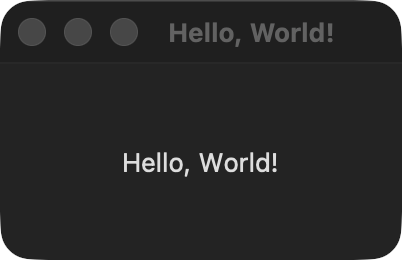

# Perl · desktop: Hello, World!

> Part of [Hello World in many languages](../../../README.md) ·
> Language overview: [Perl](../README.md)

## What this is
A desktop program that opens a native window titled **Hello, World!** with
the text **Hello, World!** inside it. The program ends when you close the
window. It uses Tkx, a Perl module that drives the Tk GUI toolkit.

This folder is a **compromise** (🔶): it does not use Perl/Tk, the
better-known Perl binding for Tk, because that needs an X11 server on
macOS. See [Why this toolchain](#why-this-toolchain).

## Prerequisites
| Tool | Version used (macOS Intel) | Why it is needed |
|---|---|---|
| Perl 5 (`perl`) | 5.34.1 (the `/usr/bin/perl` that comes with macOS) | runs `hello.pl` |
| Tcl/Tk with its development files | Tcl/Tk 9.1.0 (Homebrew `tcl-tk`) | Tk draws the window; Tcl.pm is built against Tcl |
| A C compiler and `make` | Apple clang 21.0.0 (Command Line Tools) | Tcl.pm has a part written in C |
| Tcl.pm | 1.53 (CPAN, installed into `local/`) | lets Perl create a Tcl interpreter [1] |
| Tkx | 1.10 (CPAN, installed into `local/`) | the Perl interface to Tk [2] |
| `curl` and `shasum` | the ones that come with macOS | download and check the CPAN tarballs |
| a graphical session | macOS desktop, Windows desktop, or Linux with X11/Wayland | a window needs a screen |

## Quick start
```sh
./install.sh   # check Perl and Tcl/Tk, then build Tcl.pm and Tkx into local/
./run.sh       # open the window; close it to end the program
```

## Scripts explained
| Script | What it does | Why it is needed |
|---|---|---|
| `install.sh` | 1. Checks `perl`. 2. Checks that Tcl/Tk is installed (on macOS the Homebrew `tcl-tk` formula) and offers to install it. 3. Downloads the tarballs of Tcl.pm and Tkx from CPAN, checks each SHA-256 checksum, builds them and installs them into `local/`. Every install asks first. | Perl has no GUI toolkit of its own. Tcl.pm contains C code, so it is compiled against your Tcl. The checksums prove that the files are the pinned releases. |
| `tkx-env.sh` | Sourced by the other scripts: the pinned versions, URLs and checksums, and `PERL5LIB`. Not run on its own. | One place for the pinned values, shared by `install.sh` and `run.sh`. |
| `run.sh` | Runs `perl hello.pl` with `local/lib/perl5` on `PERL5LIB`, Perl's list of module folders. `--verify` sets `TF_VERIFY=1`: the app prints `Hello, World!` once its window is shown and closes itself after 2 seconds. | One command to open the window. The self-check lets `scripts/verify-all.sh` test a GUI without anyone clicking. |

There is no `build.sh` for the program: Perl is interpreted, as in the
[cli](../cli/README.md#why-there-is-no-build-step). Only the two modules are
compiled, by `install.sh`.

## Folder structure
```text
desktop/
├── README.md      this file
├── install.sh     checks Perl and Tcl/Tk, installs Tcl.pm and Tkx
├── tkx-env.sh     pinned versions, URLs, checksums and PERL5LIB (sourced)
├── run.sh         opens the window
├── hello.pl       the program
├── .gitignore     keeps local/ out of git
└── local/         created by install.sh: tarballs in src/, modules in lib/perl5/
```
`local/` follows the layout that `INSTALL_BASE` gives: a private library
that Perl finds through `PERL5LIB` [3][18]. The tarballs are checked after
every download, so `local/src/` can be deleted and downloaded again.

## Step-by-step walkthrough
Open [`hello.pl`](hello.pl) next to this list.

1. **`use Tkx;`** loads the module. Tkx is "a bridge to Tcl that allows Tk
   based applications to be written in Perl" [2].
2. **`Tkx::widget->new(".")`** wraps Tk's root window, which Tk names `.`:
   the main window of the application. The `my $mw` declaration is needed
   because of `use strict` (see the [cli](../cli/README.md#step-by-step-walkthrough)).
3. **`$mw->g_wm_title("Hello, World!")`** sets the text of the title bar. The
   method `g_wm_title` calls Tk's `wm title` command with the window as first
   argument [2][4]. Tkx is "a very thin wrapper on top of Tcl", so what you read
   in the Tcl/Tk manual is what happens [2].
4. **`new_ttk__label(-text => "Hello, World!", -padding => "60 40")`** creates a
   label inside the window. `ttk::label` "displays a textual label and/or
   image" [5]. A double underscore in a Tkx name stands for `::` in Tcl [2].
   `=>` is Perl's "fat comma", which pairs an option with its value. The
   padding adds space around the text so the window is not tiny.
5. **`$label->g_pack`**: `pack` is "a geometry manager that arranges the
   children of a parent by packing them in order around the edges of the
   parent" [6]. A widget that no geometry manager has placed is not shown.
6. **The self-check** (`if (($ENV{TF_VERIFY} // '') eq '1')`) only runs under
   `./run.sh --verify`. `Tkx::update()` makes Tk process all pending events,
   which brings "the application 'up to date'" [7], so the window is drawn.
   `g_winfo_viewable` is true if the window is mapped (shown) [8]. Then the
   label's text is printed and `Tkx::after(2000, sub { ... })` closes the
   window 2000 ms later [9]. `sub { ... }` is an anonymous function, a
   value that holds code. Waiting for a "visibility" event does not work with
   Tk 9.1 on macOS, so the program asks for the window state after an
   `update`, as the other Tk desktop examples do.
7. **`Tkx::MainLoop()`** "will enter the Tk mainloop and start processing
   events" [2]. This *event loop* is the big difference from the
   [cli](../cli/hello.pl), which runs once and ends. The [web](../web/app.pl)
   server has a loop too, waiting for requests.

## Why this toolchain
**This is a compromise.** The better-known way to draw windows in Perl is
Perl/Tk (the `Tk` distribution on CPAN) [10]. It is not used here, for this
reason: on macOS it needs an X11 server. Its `README.darwin` for macOS tells
the reader to "install the X11 SDK ... else the make will fail" [11]. macOS
has no X11 of its own: XQuartz, the open-source X11 for macOS, is a
separate project and a separate install, and Apple shipped X11 only with OS
X 10.5 through 10.7 [17]. The development machine has no X11 installed, and
a window drawn through X11 would not be a native macOS window. This folder
was therefore not built with Perl/Tk, and nothing here claims that Perl/Tk
works on this machine.

**Tkx** is used instead, and it does the same job through a different
route. Tcl.pm embeds a Tcl interpreter in Perl [1], and Tkx talks to Tk
through it [2]. The Tcl/Tk is the system one: on macOS the same Homebrew
`tcl-tk` 9.1.0 [12] that the Python and Ruby desktop examples of this
repository use, drawing native (Aqua) windows with no X11. So the
compromise costs no extra GUI stack, but it has two prices:

- the toolkit is a Tcl/Tk install plus a C compilation of Tcl.pm, instead of
  one `cpan` command;
- Tkx 1.10 was released in 2021 [2], and its API is a thin layer over Tcl,
  so the code reads like Tcl/Tk documentation (`new_ttk__label`, `g_pack`)
  and not like typical Perl.

Because the modules are downloaded from CPAN, `install.sh` checks the
SHA-256 checksum of each tarball against the value pinned in `tkx-env.sh`.
The same values are listed by the MetaCPAN release records of Tcl and
Tkx [1][2].

## Platform notes
| Platform | Status | Notes |
|---|---|---|
| macOS Intel | ✅ verified (2026-11-04) | System Perl 5.34.1, Tcl/Tk 9.1.0 from Homebrew `tcl-tk`, Tcl.pm 1.53, Tkx 1.10, Apple clang 21.0.0. Homebrew says "Intel macOS remains Tier 3", where "bottles will rarely be built or published" [13], so `brew install tcl-tk` builds from source here (about 5 minutes on the development machine). If the program is started without a terminal (for example by a script with no tty), Tk also opens its own "Console" window, which is not part of this program. |
| macOS Apple Silicon | ⚠️ not verified | Same commands as Intel: `brew install tcl-tk` (Homebrew provides a ready-made package for Apple Silicon [12]), then `./install.sh`. |
| Linux (Debian/Ubuntu) | ✅ verified in CI (2026-11-06) | GitHub Actions `ubuntu-latest` (Ubuntu 26.04, x86_64). `install.sh` installs `perl` with apt when it is missing, and `tcl-dev` and `tk-dev` when the Tcl development files are missing [14][15]. Then it builds Tcl.pm and Tkx against Tcl 8.6 into `local/`. The window opens on a virtual X display (Xvfb). |
| Windows (Git Bash / WSL) | ✅ verified in CI (2026-11-06) | GitHub Actions `windows-latest` (Windows Server 2025), Git Bash. The Perl of Git Bash cannot build modules, so `install.sh` installs the MSYS2 packages for Perl, GCC, `mingw32-make`, Tcl 8.6 and Tk 8.6 with `pacman` (MSYS2 is pre-installed in `C:\msys64`). Then it builds Tcl.pm and Tkx against MSYS2's Tcl/Tk into `local/`. Strawberry Perl [16] would also work. WSL not verified; it behaves like Linux. |

## Expected output
`./run.sh` opens a small window titled "Hello, World!" with the text
"Hello, World!" in the middle (macOS, dark mode):



(Taken on 2026-11-04 on macOS Intel with `screencapture -x -o -l <window-id> screenshot.png`,
which captures only that window. It needs the Screen & System Audio Recording
permission in System Settings → Privacy & Security.)

`./run.sh --verify` prints:
```text
==> Open the Hello World window
    WHY: Tkx asks Tk to create a native window; MainLoop keeps it open.
Hello, World!
```

## Sources
1. Tcl: Tcl extension module for Perl (release 1.53). Vadim Konovalov and others, MetaCPAN. <https://metacpan.org/pod/Tcl> (accessed 2026-11-04)
2. Tkx: Yet another Tk interface (release 1.10). Gisle Aas and others, MetaCPAN. <https://metacpan.org/pod/Tkx> (accessed 2026-11-04)
3. ExtUtils::MakeMaker: INSTALL_BASE. Perl 5 porters, MetaCPAN. <https://metacpan.org/pod/ExtUtils::MakeMaker#INSTALL_BASE> (accessed 2026-11-04)
4. wm. Tcl/Tk 9.0 manual. <https://www.tcl-lang.org/man/tcl9.0/TkCmd/wm.html> (accessed 2026-11-04)
5. ttk::label. Tcl/Tk 9.0 manual. <https://www.tcl-lang.org/man/tcl9.0/TkCmd/ttk_label.html> (accessed 2026-11-04)
6. pack. Tcl/Tk 9.0 manual. <https://www.tcl-lang.org/man/tcl9.0/TkCmd/pack.html> (accessed 2026-11-04)
7. update. Tcl/Tk 9.0 manual. <https://www.tcl-lang.org/man/tcl9.0/TclCmd/update.html> (accessed 2026-11-04)
8. winfo. Tcl/Tk 9.0 manual. <https://www.tcl-lang.org/man/tcl9.0/TkCmd/winfo.html> (accessed 2026-11-04)
9. after. Tcl/Tk 9.0 manual. <https://www.tcl-lang.org/man/tcl9.0/TclCmd/after.html> (accessed 2026-11-04)
10. Tk: a graphical user interface toolkit for Perl (Perl/Tk, release 804.036). MetaCPAN. <https://metacpan.org/dist/Tk> (accessed 2026-11-04)
11. README.darwin in Tk-804.036 (Perl/Tk). Perl/Tk authors, MetaCPAN. <https://metacpan.org/release/SREZIC/Tk-804.036/source/README.darwin> (accessed 2026-11-04)
12. `tcl-tk` formula. Homebrew. <https://formulae.brew.sh/formula/tcl-tk> (accessed 2026-11-04)
13. Support Tiers. Homebrew. <https://docs.brew.sh/Support-Tiers> (accessed 2026-11-04)
14. `tcl-dev` package (Debian stable). Debian. <https://packages.debian.org/stable/tcl-dev> (accessed 2026-11-04)
15. `tk-dev` package (Debian stable). Debian. <https://packages.debian.org/stable/tk-dev> (accessed 2026-11-04)
16. Perl Download. perl.org. <https://www.perl.org/get.html> (accessed 2026-11-04)
17. XQuartz. The XQuartz project. <https://www.xquartz.org/> (accessed 2026-11-04)
18. perlrun: PERL5LIB. Perl 5 porters, perldoc.perl.org. <https://perldoc.perl.org/perlrun> (accessed 2026-11-04)
