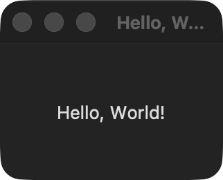

# Python · desktop: Hello, World!

> Part of [Hello World in many languages](../../../README.md) ·
> Language overview: [Python](../README.md)

## What this is
A desktop program that opens a native window titled **Hello, World!** with
the text **Hello, World!** inside it. The program ends when you close the
window. It uses tkinter, the GUI module that comes with Python.

## Prerequisites
| Tool | Version used (macOS Intel) | Why it is needed |
|---|---|---|
| Python 3 (`python3.14` on macOS, `python3` elsewhere) | 3.14.10 (Homebrew `python@3.14`) | runs `hello.py` |
| tkinter + Tcl/Tk | Tcl/Tk 9.1.0 (Homebrew `python-tk@3.14` 3.14.10 and `tcl-tk`) | draws the window |
| a graphical session | macOS desktop, Windows desktop, or Linux with X11/Wayland | a window needs a screen |

The Python docs say: "Tcl/Tk 8.5.12 is the minimum supported version; the
official Python binary release bundles Tcl/Tk 9.0" [1].

On macOS the scripts call `python3.14`, not `python3`. Homebrew's
`python@3.14` puts only versioned names on PATH; "Unversioned names such as
`python` ... are installed into `$(brew --prefix python)/libexec/bin`" [9],
and a plain `python3` on macOS is often Apple's older `/usr/bin/python3`.
The python.org installer provides `python3.14` too. Set `PYTHON=python3` (or
any other command) to override this.

## Quick start
```sh
./install.sh   # check Python and tkinter (asks before installing)
./run.sh       # open the window; close it to end the program
```

## Scripts explained
| Script | What it does | Why it is needed |
|---|---|---|
| `install.sh` | 1. Checks the interpreter (`python3.14` on macOS, `python3` elsewhere). 2. Checks that this Python can `import tkinter` and prints its Tcl/Tk version. If tkinter is missing it shows the right package (`python-tk@3.14` on Homebrew, `python3-tk` on Debian/Ubuntu) and installs it only if you answer `y`. | tkinter is "an optional module. If it is missing from your copy of CPython, look for documentation from your distributor" [1]. Homebrew ships it as a separate formula [2], Debian as a separate package [3]. |
| `run.sh` | Runs `python3.14 hello.py` (macOS) or `python3 hello.py`. `--verify` sets `TF_VERIFY=1`: the app prints `Hello, World!` once its window is shown and closes itself after 2 seconds. | One command to open the window. The self-check lets `scripts/verify-all.sh` test a GUI without anyone clicking. |

There is no `build.sh`, because Python is interpreted, as in the
[cli](../cli/README.md#why-there-is-no-build-step).

## Folder structure
```text
desktop/
├── README.md      this file
├── install.sh     checks Python and tkinter
├── run.sh         opens the window
└── hello.py       the program
```
Like the [cli](../cli/README.md#folder-structure), this is a single script, not a
package for distribution. tkinter is in Python's standard library, so there
is no `requirements.txt` (compare with [../web](../web/README.md)).

## Step-by-step walkthrough
Open [`hello.py`](hello.py) next to this list.

1. **Imports.** `import tkinter as tk` loads the module under a short name.
   `from tkinter import ttk` loads the themed widgets, whose look "adapt[s]
   ... to the platform's native theme" [4].
2. **`root = tk.Tk()`** "initializes Tk and creates its associated Tcl
   interpreter. It also creates a toplevel window, known as the root
   window, which serves as the main window of the application" [1].
3. **`root.title(...)`** sets the text of the title bar.
4. **`ttk.Label(root, text="Hello, World!", padding=40)`** creates a label
   inside the root window. `padding` adds space so the window is not tiny.
5. **`label.pack()`**: "Creating a widget does not display it. A widget
   appears only after it has been handed to a geometry manager" [1]. `pack`
   is the simplest geometry manager; `grid` and `place` are the others.
6. **The self-check** (`if os.environ.get("TF_VERIFY") == "1":`) only runs
   under `./run.sh --verify`. `update()` makes Tk process all pending
   events, which "bring[s] the application 'up to date'" [10], so the window
   is drawn. `winfo_viewable()` is true if the window is "mapped" (shown)
   [1]. Then the label's text is printed and `after(2000, root.destroy)`
   closes the window 2000 ms later. The method `wait_visibility()` [1] seems a
   better fit, but with Tk 9.1 on macOS it never returned on the dev
   machine, because no visibility event arrived.
7. **`root.mainloop()`** "puts everything on the display, and responds to
   user input until the program terminates" [1]. This *event loop* is the
   big difference from the [cli](../cli/hello.py), which runs once and ends.
   The [web](../web/app.py) server has a loop too, waiting for requests.

## Why this toolchain
- **tkinter** is "the standard Python interface to the Tcl/Tk GUI toolkit",
  and "both Tk and tkinter are available on most Unix platforms, including
  macOS, as well as on Windows systems" [1]. The python.org installers
  include it [1][5], so no extra library from PyPI is needed.
- The python.org macOS installer includes "a macOS-native version of Tk"
  [5]. On Homebrew it is the `python-tk@3.14` formula, which must match
  the Python version (`python@3.14`) [2].
- **ttk** widgets are used instead of the classic ones because they "provide
  a much better appearance on different platforms" [1].

## Platform notes
| Platform | Status | Notes |
|---|---|---|
| macOS Intel | ✅ verified (2026-10-31) | Python 3.14.10 with Homebrew `python-tk@3.14` and Tcl/Tk 9.1.0. Homebrew says "Intel macOS remains Tier 3", where "bottles will rarely be built or published" [6], so `brew install python-tk@3.14` built `tcl-tk` and `python-tk@3.14` from source (on 2026-10-31 with the Command Line Tools 26.6, `tcl-tk` took about 5 minutes and `python-tk@3.14` about 20 seconds, after `python@3.14` itself took about 10 minutes; an outdated `/Applications/Xcode.app` left on the machine had made an earlier attempt fail). |
| macOS Apple Silicon | ⚠️ not verified | `brew install python@3.14 python-tk@3.14`, or the python.org installer, which includes Tk [5]. |
| Linux (Debian/Ubuntu) | ⚠️ not verified | `sudo apt-get install -y python3-tk` [3]. Needs a desktop session (X11 or Wayland). |
| Windows (Git Bash / WSL) | ⚠️ not verified | Install Python with the Python install manager [7], then check with `py -m tkinter`. In Git Bash: `PYTHON=python ./run.sh`. Native: `py hello.py`. WSL shows Linux GUI apps on the Windows desktop through WSLg [8]. |

## Expected output
`./run.sh` opens a small window titled "Hello, World!" with the text
"Hello, World!" in the middle (macOS, dark mode):



(Taken on 2026-10-31 on macOS Intel with `screencapture -o -l <window-id> screenshot.png`,
which captures only that window. It needs the Screen & System Audio Recording
permission in System Settings → Privacy & Security.)

`./run.sh --verify` prints:
```text
==> Open the Hello World window
    WHY: tkinter asks Tk to create a native window; mainloop() keeps it open.
Hello, World!
```

## Sources
1. tkinter: Python interface to Tcl/Tk. Python Software Foundation. <https://docs.python.org/3/library/tkinter.html> (accessed 2026-10-30)
2. `python-tk@3.14` formula. Homebrew. <https://formulae.brew.sh/formula/python-tk@3.14> (accessed 2026-10-30)
3. `python3-tk` package (Debian stable). Debian. <https://packages.debian.org/stable/python3-tk> (accessed 2026-10-30)
4. tkinter.ttk: Tk themed widgets. Python Software Foundation. <https://docs.python.org/3/library/tkinter.ttk.html> (accessed 2026-10-30)
5. Using Python on macOS. Python Software Foundation. <https://docs.python.org/3/using/mac.html> (accessed 2026-10-30)
6. Support Tiers. Homebrew. <https://docs.brew.sh/Support-Tiers> (accessed 2026-10-30)
7. Using Python on Windows. Python Software Foundation. <https://docs.python.org/3/using/windows.html> (accessed 2026-10-30)
8. Run Linux GUI apps on the Windows Subsystem for Linux. Microsoft Learn. <https://learn.microsoft.com/en-us/windows/wsl/tutorials/gui-apps> (accessed 2026-10-30)
9. Language Runtimes and Packages. Homebrew. <https://docs.brew.sh/Language-Runtimes-and-Packages> (accessed 2026-10-31)
10. update. Tcl/Tk 9.0 manual. <https://www.tcl-lang.org/man/tcl9.0/TclCmd/update.html> (accessed 2026-10-31)
