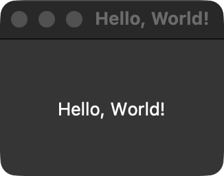

# Ruby · desktop: Hello, World!

> Part of [Hello World in many languages](../../../README.md) ·
> Language overview: [Ruby](../README.md)

## What this is
A small desktop application. It opens a window titled "Hello, World!" that
shows the text **Hello, World!**. The window is drawn by Tk, a GUI toolkit,
and Ruby reaches Tk through the `tk` gem (Ruby/Tk). The program ends when you
close the window.

## Prerequisites
| Tool | Version used (macOS Intel) | Why it is needed |
|---|---|---|
| Ruby (`ruby`) | 4.0.7 (Homebrew `ruby`) | runs `hello.rb` |
| Bundler (`bundle`) | 4.0.20 (installed with Ruby) | installs the pinned gem into `vendor/bundle` and runs Ruby with it |
| Tcl/Tk | 9.1.0 (Homebrew `tcl-tk`) | the libraries that draw the window; the gem is built against them |
| `tk` gem | 0.6.0 (pinned in `Gemfile` and `Gemfile.lock`) | Ruby's interface to Tk |
| A C compiler | Apple Command Line Tools | builds the C part of the `tk` gem |

The `tk` gem is described as "Tk interface module using tcltklib" [1][2]. A
gem with a C part is called a native extension: it is compiled on your
computer when you install it.

## Quick start
```sh
./install.sh   # check Ruby, Tcl/Tk and Bundler, build the tk gem (asks first)
./run.sh       # open the window
```
Close the window to end the program. The gem build takes about a minute.

## Scripts explained
| Script | What it does | Why it is needed |
|---|---|---|
| `install.sh` | 1. Checks Ruby and Bundler. 2. Checks that Homebrew's `tcl-tk` is installed and reads its version. 3. Runs `bundle config set --local path vendor/bundle` and `bundle config set --local build.tk <flags>`. 4. Runs `bundle install`, which builds the gem. Every step that installs something asks first. | Ruby/Tk must be compiled against Tcl/Tk. Bundler passes build options to a gem through `bundle config set build.<gem>` [3]. The `--local` setting is saved in the app's own `.bundle/config` [3], and `path vendor/bundle` keeps the gem out of your system Ruby. |
| `run.sh` | Runs `bundle exec ruby hello.rb`. `--verify` sets `TF_VERIFY=1`: the app prints `Hello, World!` once its window is shown, then closes itself after about 2 seconds. | `bundle exec` runs Ruby "in the current bundle context, making all gems in Gemfile available to require and use" [4]. The self-check lets `scripts/verify-all.sh` test the window without a person closing it. |

There is no `build.sh` for the program itself, because Ruby is interpreted,
as in the [cli](../cli/README.md#why-there-is-no-build-step). Only the gem has
a build, and `bundle install` runs it.

## Folder structure
```text
desktop/
├── README.md      this file
├── install.sh     checks Ruby, Tcl/Tk, Bundler; builds the tk gem
├── run.sh         opens the window
├── hello.rb       the program (Ruby/Tk)
├── Gemfile        the gem this program needs, with its pinned version
├── Gemfile.lock   the exact versions Bundler chose (committed)
├── .gitignore     keeps vendor/ and .bundle/ out of git
├── .bundle/       created by install.sh: Bundler settings for this folder
└── vendor/bundle/ created by install.sh: the installed gem
```
- `Gemfile` lists the gems and where to download them (`source`) [5].
- `Gemfile.lock` "writes the exact version of every gem, direct or
  transitive, into the lockfile", so "every machine, every teammate, and
  every deploy runs the same code" [6]. Bundler maintains it; nobody edits
  it by hand.
- `.bundle/` and `vendor/` are not committed: they hold settings for your
  computer (the Tcl/Tk path) and compiled code.

## Step-by-step walkthrough
Open [`hello.rb`](hello.rb) next to this list.

1. **`require "tk"`** loads the gem. It is the Ruby counterpart of
   Python's `import tkinter`. Unlike the [cli](../cli/hello.rb), this
   program depends on a library that is not part of the language.
2. **`TkRoot.new { title "Hello, World!" }`** creates the root window, the
   main window of the application, and sets its title. The block holds the
   window's options.
3. **`TkLabel.new(root) do ... end`** creates a label: Tk describes it as a
   "non-interactive text or image widget" [7]. `root` says that it lives in
   that window; `padx` and `pady` add empty space around the text.
4. **`label.pack`** places the label. `pack` is a "Geometry manager that
   packs around edges of cavity" [8]: until a geometry manager places a
   widget, Tk does not show it. Python's tkinter uses the same name for the
   same Tk command.
5. **The self-check** (`if ENV["TF_VERIFY"] == "1"`) only runs when
   `./run.sh --verify` sets that variable. `Tk.update` calls Tk's
   `update`, which brings "the application 'up to date' by entering the
   event loop repeatedly until all pending events ... have been processed"
   [9]. After it, the window is on screen, so the program prints the label's
   text and schedules `root.destroy` with `Tk.after(2000)`. Calls that wait
   for a visibility event are avoided: with Tk 9 on macOS they did not
   return when tried.
6. **`Tk.mainloop`** hands control to Tk, which waits for events until the
   window closes. The cli version has no such loop: it prints once and ends.

## Why this toolchain
- **Ruby/Tk** is the Tk interface published in the `ruby` organization on
  GitHub [1] and on RubyGems [2]. It uses the same Tk toolkit as the
  [Python desktop](../../python/desktop/README.md) version, so the two
  programs have the same shape.
- **Tcl/Tk 9.1 from Homebrew** draws a native window on macOS (Aqua) and
  needs no X11. `Tk.windowingsystem` reports `aqua` in this setup.
- **Bundler with `vendor/bundle`** keeps the gem inside the folder. The
  Bundler documentation describes `Gemfile.lock` as the file that pins
  every gem version [6].
- **Known caveat.** The Ruby/Tk project notes that with Aqua Tk, "current
  tcltklib sometimes freezes when using Aqua specific dialogs (e.g.
  Tk.messageBox)" [10]. This program uses no dialog.

## Platform notes
| Platform | Status | Notes |
|---|---|---|
| macOS Intel | ✅ verified (2026-11-04) | Ruby 4.0.7, `tk` gem 0.6.0, Homebrew `tcl-tk` 9.1.0 (Aqua). `bundle install` compiles the gem in about a minute. |
| macOS Apple Silicon | ⚠️ not verified | Same commands as Intel; `install.sh` finds Tcl/Tk with `brew --prefix tcl-tk`. |
| Linux (Debian/Ubuntu) | ✅ verified in CI (2026-11-06) | <!-- vale Vale.Terms = NO -->GitHub Actions `ubuntu-latest` (Ubuntu 26.04, x86_64). `install.sh` installs `ruby-full` and `build-essential` with apt when `ruby` is missing, and `bundler` when `bundle` is missing. If the Tcl/Tk headers are missing it installs `tk-dev`, `ruby-dev` and `build-essential`; the Debian package `tk-dev` depends on Tk 8.6 [11]. It passes the Debian Tcl/Tk folders to the `tk` gem build [1]. The window opens on a virtual X display (Xvfb). |
| Windows (Git Bash / WSL) | ✅ verified in CI (2026-11-06) | GitHub Actions `windows-latest` (Windows Server 2025), Git Bash. The Ruby of the runner image has no Bundler, so `install.sh` installs the MSYS2 packages for Ruby 4.0 (with Bundler), GCC, `make`, Tcl 8.6 and Tk 8.6 with `pacman` (MSYS2 is pre-installed in `C:\msys64`). It builds the `tk` gem against `C:/msys64/ucrt64` [1]. WSL not verified; it behaves like Linux. |

## Expected output
`./run.sh` opens a small window titled "Hello, World!" with the text
"Hello, World!" in the middle (macOS, dark mode):



(Taken on 2026-11-04 on macOS Intel with `screencapture -x -o -l <window-id> screenshot.png`,
which captures only that window. It needs the Screen & System Audio
Recording permission in System Settings → Privacy & Security. The window
is gray because it is not the active window while the screenshot is taken.)

`./run.sh --verify` prints:
```text
==> Open the Hello World window
    WHY: Ruby/Tk asks Tk to create a native window; Tk.mainloop keeps it open.
Hello, World!
```
and closes the window after about 2 seconds.

## Sources
1. `ruby/tk`: Tk interface module using `tcltklib` (README). Ruby project. <https://github.com/ruby/tk> (accessed 2026-11-04)
2. `tk` 0.6.0. RubyGems.org. <https://rubygems.org/gems/tk> (accessed 2026-11-04)
3. bundle config. Bundler documentation, RubyGems Guides. <https://guides.rubygems.org/command-reference/bundle-config/> (accessed 2026-11-04)
4. Using Bundler in applications. RubyGems Guides. <https://guides.rubygems.org/using_bundler_in_applications/> (accessed 2026-11-04)
5. Gemfile. RubyGems Guides. <https://guides.rubygems.org/gemfile/> (accessed 2026-11-04)
6. How Gemfile.lock works. RubyGems Guides. <https://guides.rubygems.org/gemfile-lock/> (accessed 2026-11-04)
7. label. Tk 9.0 manual. <https://www.tcl-lang.org/man/tcl9.0/TkCmd/label.html> (accessed 2026-11-04)
8. pack. Tk 9.0 manual. <https://www.tcl-lang.org/man/tcl9.0/TkCmd/pack.html> (accessed 2026-11-04)
9. update. Tcl/Tk 9.0 manual. <https://www.tcl-lang.org/man/tcl9.0/TclCmd/update.html> (accessed 2026-11-04)
10. README.macosx-aqua. Ruby/Tk project. <https://github.com/ruby/tk/blob/master/README.macosx-aqua> (accessed 2026-11-04)
11. `tk-dev` package (Debian stable). Debian. <https://packages.debian.org/stable/tk-dev> (accessed 2026-11-04)
