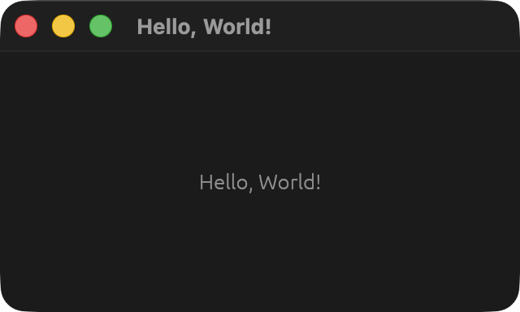

# Rust · desktop: Hello, World!

> Part of [Hello World in many languages](../../../README.md) ·
> Language overview: [Rust](../README.md)

## What this is
A desktop program that opens a small window titled "Hello, World!" with the
text **Hello, World!** in the middle. The window is drawn by **egui**, "a
simple, fast, and highly portable immediate mode GUI library for Rust",
through **eframe**, "the official egui framework, which supports writing
apps for Web, Linux, Mac, Windows, and Android" [1]. Rust's standard library
has no GUI (Python ships tkinter), so eframe is a dependency: `Cargo.toml`
names it and `cargo build` downloads it.

Compare [../cli](../cli/): the program no longer prints and ends. It hands
control to eframe's event loop, which waits for window events until you
close the window.

## Prerequisites
| Tool | Version used (macOS Intel) | Why it is needed |
|---|---|---|
| Rust 1.95 or newer (`rustc` + `cargo`) | Rust 1.98.1 (Homebrew) | builds the program; downloads eframe |
| eframe (with egui) | 0.37.0 (published 2026-10-15) [6] | the GUI framework; downloaded by `cargo build`, not by `install.sh` |
| Linux only: window-system libraries | not verified | X11/Wayland development packages (see Platform notes) |

The minimum is higher than in [../cli](../cli/) (1.85): eframe 0.37.0
declares `rust_version` 1.95 [6], and `Cargo.toml` repeats it. Rust 1.95.0
was released on 2026-04-16 [7]. On macOS nothing else is needed: no Xcode
and no C compiler beyond the linker Rust already uses (compare
[../../go/desktop](../../go/desktop/), where Fyne needs cgo).

## Quick start
```sh
./install.sh   # check / install Rust (asks before installing)
./build.sh     # download eframe and compile (first time: about 5 minutes)
./run.sh       # open the window; close it to end the program
```

## Scripts explained
| Script | What it does | Why it is needed |
|---|---|---|
| `install.sh` | Same check as [../cli](../cli/README.md#scripts-explained), with minimum Rust 1.95. On Linux it also prints the `apt-get` command for the window libraries (not run: it needs `sudo`). | eframe is a dependency of this project, not a tool on your computer, so Cargo downloads it during the build, as Maven downloads JavaFX in [../../java/desktop](../../java/desktop/). |
| `build.sh` | Runs `cargo build --release --locked` [2] | The first build downloads and compiles eframe, egui, and the crates they use: 179 on macOS (counted with `cargo tree`). `Cargo.lock` lists 427, because it also records crates used only on other systems (Windows, Linux, Android, the web). On the test machine, the first clean build took 4 min 18 s; later builds recompile only `main.rs`. |
| `run.sh` | Runs `./target/release/hello-desktop`. `--verify` sets `TF_VERIFY=1`: the app prints the label's text on its first frame and closes itself after about 2 seconds. | The executable already contains eframe and egui. Only the operating system's own libraries are loaded at run time: on macOS, `otool -L` lists AppKit, Metal, QuartzCore, and CoreText, among others. |

## Folder structure
```text
desktop/
├── README.md        this file
├── install.sh       checks / installs Rust
├── build.sh         downloads eframe and compiles
├── run.sh           opens the window
├── screenshot.png   the window, for "Expected output" below
├── Cargo.toml       the manifest: name, edition, minimum Rust, the dependency eframe
├── Cargo.lock       the exact version and checksum of every crate (written by cargo)
├── src/
│   └── main.rs      the program
└── target/          created by build.sh; not committed
    └── release/
        └── hello-desktop
```
- The same Cargo layout as [../cli](../cli/README.md#folder-structure):
  "The default executable file is src/main.rs" [3].
- **`eframe = "0.37"`** accepts any 0.37.x release but not 0.38: for
  versions below 1.0, "0.2.3 := >=0.2.3, <0.3.0" [4]. egui is still at 0.x
  and its API changes between minor releases (in 0.37 the app is written
  as a `ui` function), so this matters.
- **`Cargo.lock`** is committed, as in [../web](../web/README.md#folder-structure),
  so every student builds the same 427-entry dependency tree.
- eframe is used with its default features. Its default renderer is
  **wgpu**: "Switching from `wgpu (the default)` to `glow` can
  significantly reduce your binary size" [5]. wgpu "runs natively on
  Vulkan, Metal, D3D12, and OpenGL" [8]; on macOS it uses Metal, which is
  why the 15 MB executable links `Metal.framework`.

## Step-by-step walkthrough
Open [`src/main.rs`](src/main.rs) next to this list.

1. **Immediate mode.** This is the big difference from every other
   desktop version in this repository. egui's README explains: "In a
   retained GUI you create a button, add it to some UI and install some
   on-click handler (callback)". "By contrast, in immediate mode you show
   the button and interact with it immediately, and you do so every frame
   (e.g. 60 times per second)" [1]. Therefore, unlike in tkinter, JavaFX, or
   Fyne, there is no label object here: a closure describes the whole
   window each time it is drawn.
2. **`fn main() -> eframe::Result`**: `main` returns a `Result`. "When a
   main function returns a Result<(), E>, the executable will exit with a
   value of 0 if main returns Ok(()) and will exit with a nonzero value if
   main returns an Err value" [9], for example when no graphics adapter
   is found.
3. **`eframe::NativeOptions { viewport: ..., ..Default::default() }`** sets
   the window size (320 × 160 logical points). `..Default::default()`
   fills every other field with its default value; Rust has no optional
   arguments, so this "struct update syntax" is the usual replacement.
4. **`let verify = ...; let started = ...; let mut printed = false;`**:
   "by default, variables are immutable" [10]; `mut` makes `printed`
   changeable. These three are used only by the self-check (step 7).
5. **`eframe::run_ui_native("Hello, World!", options, move |ui, _frame| { ... })`**
   is "The simplest way to get started when writing a native app" [5]. The
   first argument is the app name, which eframe also uses as the window
   title when none is set. The third is a **closure**: "Rust's closures are
   anonymous functions you can save in a variable or pass as arguments to
   other functions" [11]. `move` makes the closure "take ownership of the
   values it uses in the environment" [11] (`verify`, `started`,
   `printed`), because eframe keeps calling it after `main`'s own code has
   moved on. `run_ui_native` returns only when the window closes, like
   tkinter's `mainloop()` and Fyne's `ShowAndRun()`.
6. **`egui::CentralPanel::default().show(ui, |ui| { ... })`** fills the
   window with a panel (margins and a background color), and
   **`ui.centered_and_justified(|ui| { ui.label("Hello, World!"); })`** puts
   the label in the middle. Each nested closure receives a `ui` for the
   area inside it.
7. **The self-check** (only with `TF_VERIFY=1`, used by `./run.sh --verify`):
   on the first frame it prints `Hello, World!`; after 2 seconds it sends
   `egui::ViewportCommand::Close`, which closes the window and ends the
   event loop. egui repaints only when something happens, so
   `request_repaint_after(100 ms)` asks for the next frame that checks the
   time again. In Go the same check used a goroutine; here no thread is
   needed, because the closure runs on every frame anyway.

## Why this toolchain
- **Pure Rust, one dependency:** `Cargo.toml` names only eframe, and
  `cargo build` does the rest. On macOS none of the 179 crates compiles C
  code (`cargo tree` shows no `cc`, `cmake`, or `bindgen` crate), so there is
  no Xcode or separate GUI SDK to install. Linux needs a few system
  libraries.
- **Cross-platform:** eframe targets "Web, Linux, Mac, Windows, and
  Android" [1].
- **Maintained:** egui's "first release on crates.io (0.1.0)" was on
  2020-05-30 [12]; eframe 0.37.0 was published on 2026-10-15 [6].
- **Rust only:** eframe/egui keeps the Hello World in Rust, with no C/C++
  toolkit and no browser engine.

## Platform notes
| Platform | Status | Notes |
|---|---|---|
| macOS Intel | ✅ verified (2026-10-31) | Rust 1.98.1, eframe 0.37.0, rendered with Metal through wgpu. |
| macOS Apple Silicon | ⚠️ not verified | Same commands. |
| Linux (Debian/Ubuntu) | ⚠️ not verified | Before building, eframe 0.37's README says to run: `sudo apt-get install libxcb-render0-dev libxcb-shape0-dev libxcb-xfixes0-dev libxkbcommon-dev libssl-dev` [5]. `install.sh` prints this command. The egui repository's current README lists a longer command (it adds `libclang-dev libgtk-3-dev`) [1]; use it if the build still fails. wgpu uses Vulkan or OpenGL there [8]. |
| Windows (Git Bash / WSL) | ⚠️ not verified | Rust with rustup and the MSVC Build Tools, as in [../cli](../cli/README.md#platform-notes). wgpu uses D3D12 or Vulkan [8]. The executable is `target\release\hello-desktop.exe`. Under WSL a window needs WSLg. |

## Expected output
`./run.sh` opens this window (on the test machine, macOS was in dark mode,
and egui followed it):



(Taken on 2026-10-31 on macOS Intel with `screencapture -x -o -l <window-id> screenshot.png`,
which captures only that window.)

`./run.sh --verify` prints:
```text
==> Open the Hello World window
    WHY: eframe, linked into target/release/hello-desktop, opens the window; egui draws it with the GPU.
    Self-check: the app prints the label text and closes after ~2 seconds.
Hello, World!
```

## Sources
1. emilk/egui (README: description, immediate mode, eframe, Linux packages). GitHub. <https://github.com/emilk/egui> (accessed 2026-10-31)
2. The Cargo Book: `cargo build`. The Rust Project. <https://doc.rust-lang.org/cargo/commands/cargo-build.html> (accessed 2026-10-31)
3. The Cargo Book: Package Layout. The Rust Project. <https://doc.rust-lang.org/cargo/guide/project-layout.html> (accessed 2026-10-31)
4. The Cargo Book: Specifying Dependencies (caret requirements). The Rust Project. <https://doc.rust-lang.org/cargo/reference/specifying-dependencies.html> (accessed 2026-10-31)
5. eframe 0.37.0: README, `Cargo.toml` features and API (`run_ui_native`). docs.rs and GitHub. <https://docs.rs/eframe/0.37.0/eframe/> and <https://github.com/emilk/egui/blob/0.37.0/crates/eframe/Cargo.toml> (accessed 2026-10-31; also read from the downloaded crate)
6. crates.io API: eframe 0.37.0 (publish date, `rust_version`). crates.io. <https://crates.io/api/v1/crates/eframe/0.37.0> (accessed 2026-10-31)
7. Announcing Rust 1.95.0. The Rust Release Team, 2026-04-16. <https://blog.rust-lang.org/2026/04/16/Rust-1.95.0/> (accessed 2026-10-31)
8. gfx-rs/wgpu (README: supported backends). GitHub. <https://github.com/gfx-rs/wgpu> (accessed 2026-10-31; also read from the downloaded crate wgpu 30.0.1)
9. The Rust Programming Language, ch. 9.2 "Recoverable Errors with Result". The Rust Project. <https://doc.rust-lang.org/book/ch09-02-recoverable-errors-with-result.html> (accessed 2026-10-31)
10. The Rust Programming Language, ch. 3.1 "Variables and Mutability". The Rust Project. <https://doc.rust-lang.org/book/ch03-01-variables-and-mutability.html> (accessed 2026-10-31)
11. The Rust Programming Language, ch. 13.1 "Closures". The Rust Project. <https://doc.rust-lang.org/book/ch13-01-closures.html> (accessed 2026-10-31)
12. egui CHANGELOG. emilk/egui (GitHub). <https://github.com/emilk/egui/blob/main/CHANGELOG.md> (accessed 2026-10-31)
