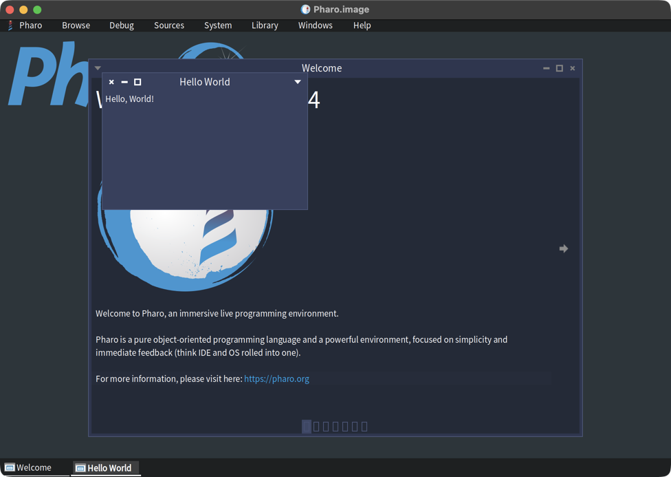

# Smalltalk · desktop: Hello, World!

> Part of [Hello World in many languages](../../../README.md) ·
> Language overview: [Smalltalk](../README.md)

## What this is

A desktop application that opens a window showing `Hello, World!` using
Pharo 14's Morphic UI toolkit. Pharo 14.0 is downloaded automatically by
`install.sh` into a local cache; no manual download is needed.

## Prerequisites

| Tool | Version used | Why it is needed |
|---|---|---|
| Pharo 14 | 14.0 (downloaded by install.sh) | Smalltalk image with Morphic UI toolkit |
| curl | system | Downloads Pharo from files.pharo.org |
| `shasum`, `unzip` | system | Check each download's SHA-256 digest, then unpack it |

## Quick start

```sh
./install.sh   # download Pharo 14 into ../.cache/pharo14/
./run.sh       # open the Hello World window
```

## Scripts explained

| Script | What it does | Why it is needed |
|---|---|---|
| `install.sh` | Asks first, then downloads the Pharo 14 image and the VM for your system from files.pharo.org into a shared cache, checks the SHA-256 digest of each ZIP against `pharo-env.sh`, unpacks them and writes the `pharo` and `pharo-ui` launchers | Pharo is not in any package manager; the Pharo project publishes the image and VM as ZIP files |
| `run.sh` | Opens the Morphic window via `pharo-ui Pharo.image st hello.st`; `--verify` sets `TF_VERIFY=1`, so the app also prints the greeting and closes after about 2 seconds | Morphic needs the UI launcher; the self-check runs the same window code |

## Folder structure

```text
desktop/
├── README.md      this file
├── install.sh     downloads Pharo 14 into ../.cache/pharo14/
├── pharo-env.sh   shared Pharo paths, download URLs and digests (sourced by install.sh and run.sh)
├── run.sh         opens the window; with --verify it also runs the self-check
├── screenshot.png the window, for "Expected output" below
└── hello.st       the Morphic source code
```

Cache location: `languages/smalltalk/.cache/pharo14/` (git-ignored).
Source: [files.pharo.org](https://files.pharo.org/get-files/140/)

## Step-by-step walkthrough

1. **`greeting := 'Hello, World!'`** — assigns the greeting string to a temporary
   variable. In Smalltalk, `:=` is the assignment operator. String literals use
   single quotes. Compare with `let greeting = "Hello, World!"` in JavaScript.

2. **`window := SystemWindow labelled: 'Hello World'`** — creates a titled window.
   `SystemWindow` is the standard window class in Pharo 14's Morphic framework.
   `labelled:` is a class-side factory method that sets the window title. Compare
   with Java's `JFrame("Hello World")` or Python's `tk.Tk()`.

3. **`text := TextMorph new`** — creates a text display morph. `TextMorph` is a
   Morph that shows editable or read-only text. Every UI element in Morphic is a
   Morph — an object that knows how to draw itself and respond to events.

4. **`text contents: greeting`** — sets the text content. Smalltalk uses
   keyword messages (messages with colons) to pass arguments: `contents:` is the
   setter for the displayed text. Compare with `label.text = greeting` in Swift.

5. **`window addMorph: text frame: (0 @ 0 corner: 1 @ 1)`** — adds the TextMorph
   as a child of the window's content area, below the title bar. The frame is a
   fraction of that area (here all of it). Morphic uses a tree of Morphs; each
   Morph can hold sub-Morphs.
   Compare with HTML's `appendChild` or Java's `frame.add(label)`.

6. **`window openInWorld`** — opens the window in the Morphic World (the main
   display surface). After this call, Pharo's event loop keeps the window alive
   until the user closes it.

## Why this toolchain

Morphic is the original Smalltalk GUI framework, created at Xerox PARC as part
of Smalltalk-80. It is included in Pharo and is the standard way to build
graphical applications in Smalltalk. Every UI element is a Morph — an object
that knows how to draw itself and respond to events. Source: [Pharo documentation](https://pharo.org/documentation).

### The image-based workflow

Pharo is an **image-based** system. Unlike most languages where you compile source
code into an executable, Pharo keeps a snapshot of a running system (the
"image") that holds all objects, including classes and compiled methods, such as
the libraries, the UI toolkit and any code you have written. The VM is a separate
program that loads the image. When you start Pharo with
`pharo-ui Pharo.image st file.st`, the VM loads the image and evaluates the file
inside it. Source: [Pharo by Example](https://books.pharo.org/updated-pharo-by-example/).

## Platform notes

| Platform | Status | Notes |
|---|---|---|
| macOS Intel | ✅ verified (2026-11-19) | Pharo 14.0, downloaded by install.sh |
| macOS Apple Silicon | ⚠️ not verified | `install.sh` downloads `pharo-vm-Darwin-arm64-stable.zip` |
| Linux (Debian/Ubuntu) | ⚠️ not verified | `install.sh` downloads `pharo-vm-Linux-x86_64-stable.zip` (x86_64 only); Xvfb provides display |
| Windows (Git Bash) | ⚠️ not verified | `install.sh` downloads `pharo-vm-Windows-x86_64-stable.zip` and starts `PharoConsole.exe` |

**Download digests.** Pharo publishes no checksums, so the SHA-256 digests in
`pharo-env.sh` were computed with `shasum -a 256` on files downloaded from
files.pharo.org on 2026-11-19. The image is a fixed build (build 789, commit
`e649a7f87c`). The VM ZIPs are the `stable` files that get.pharo.org itself
downloads, so their names stay the same when Pharo publishes a new VM. If a
download no longer matches its digest, `install.sh` stops before unpacking
anything; check the new file, then update the digest in `pharo-env.sh`.

## Expected output

A window titled "Hello World" opens inside the Pharo window, showing the
text `Hello, World!`. Pharo also opens its own Welcome window behind it.



(Taken on 2026-11-19 on macOS Intel with `screencapture -x -o -l <window-id> screenshot.png`,
which captures only that window. It needs the Screen & System Audio
Recording permission in System Settings → Privacy & Security.)
In `--verify` mode: the window opens, `Hello, World!` is printed to stdout, and
Pharo quits after about 2 seconds.

## Sources

1. Pharo by Example (updated). Ducasse, Zagidulin, Hess, Chloupis. <https://books.pharo.org/updated-pharo-by-example/> (accessed 2026-11-17)
2. Pharo download (get.pharo.org). Pharo Project. <https://get.pharo.org> (accessed 2026-11-19)
3. Pharo by Example 5. Pharo consortium (2024). <https://books.pharo.org/pharo-by-example/> (accessed 2026-11-10)
4. Morphic documentation. Pharo Project. <https://pharo.org/documentation> (accessed 2026-11-10)
5. Pharo 14 files (image and VM ZIPs). Pharo Project. <https://files.pharo.org/get-files/140/> (accessed 2026-11-19)
